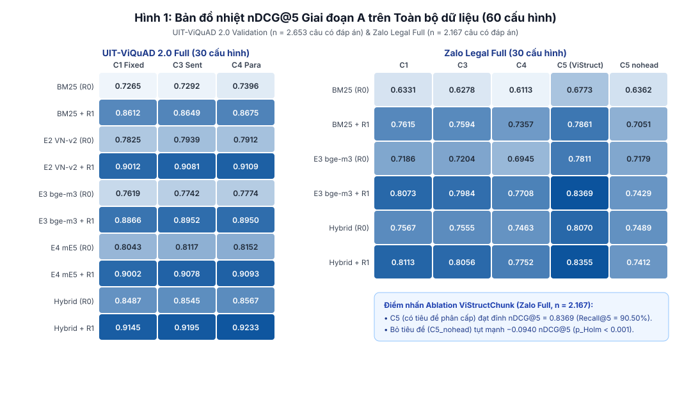
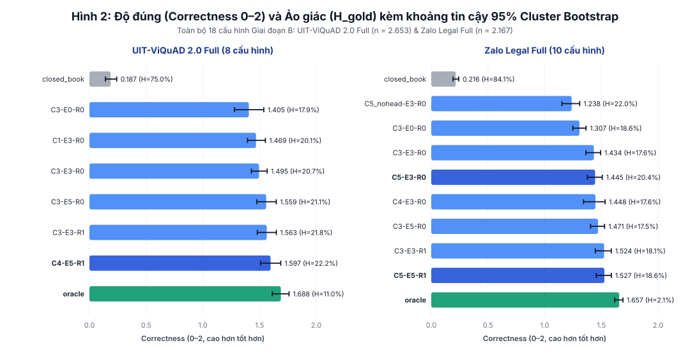
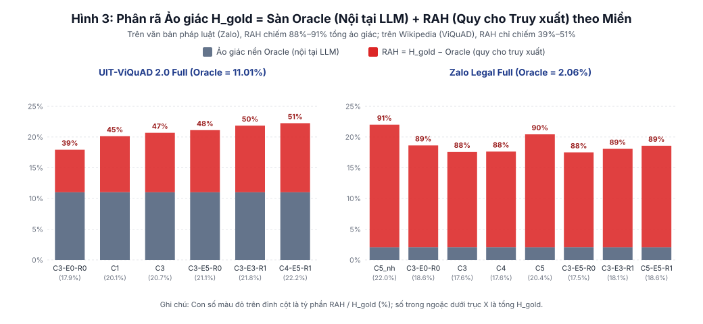

# Ảnh hưởng của Phân đoạn, Truy xuất và Xếp hạng lại đến Độ chính xác và Ảo giác trong Hệ thống RAG Tiếng Việt

## Tóm tắt (Abstract)

Các nghiên cứu về hệ thống Retrieval-Augmented Generation (RAG) cho tiếng Việt hiện nay thường đánh giá tách rời chất lượng truy xuất (Recall, nDCG) hoặc phát hiện ảo giác mà chưa định lượng mối liên kết nhân quả giữa thiết kế tầng truy xuất và tỷ lệ ảo giác của câu trả lời cuối cùng. Nghiên cứu này đề xuất một khung thực nghiệm hai giai đoạn có kiểm soát trên hai miền văn bản đối lập của tiếng Việt — bách khoa (**UIT-ViQuAD 2.0**, `3.814` câu hỏi validation đầy đủ) và pháp luật (**Zalo Legal Text Retrieval 2021**, `3.096` câu hỏi đầy đủ trên kho `61.425` điều luật) — tổng cộng **`6.910` câu hỏi thực** (`60` cấu hình truy xuất ở Giai đoạn A; `18` cấu hình đầu cuối với `59.382` câu trả lời và `42.887` lượt chấm LLM-as-Judge hợp lệ ở Giai đoạn B). Chúng tôi đóng góp: (1) chiến lược phân đoạn nhận biết cấu trúc pháp lý **`ViStructChunk` (`C5`)** gắn tiêu đề phân cấp *Văn bản / Điều / Khoản*; (2) chỉ số **`RAH` (Retrieval-Attributable Hallucination)** tách biệt phần ảo giác quy cho truy xuất khỏi sàn ảo giác nội tại (`oracle`); và (3) bộ kết quả kiểm định thống kê nghiêm ngặt với khoảng tin cậy Cluster Bootstrap 95% và kiểm định hoán vị ghép cặp hiệu chỉnh Holm–Bonferroni.

Kết quả thực nghiệm khẳng định mạnh mẽ các giả thuyết:
- Trên **Zalo Legal Full (`n = 2.167`)**, `ViStructChunk` đạt đỉnh truy xuất `nDCG@5 = 0,8369` (`Recall@5 = 90,50%`), vượt `C3` (`+0,0606` ở R0, $p_{\text{Holm}} = 0,0007$) và việc bỏ tiêu đề cha (`C5_nohead`) làm sụt giảm mạnh cả truy xuất (`-0,0943` nDCG@5 ở Hybrid+R1, $p_{\text{Holm}} = 0,0007$) lẫn độ đúng câu trả lời (`-0,2073`, $p_{\text{Holm}} = 0,0008$). `C5-E3-R0` đồng thời giảm tỷ lệ **nhầm điều luật xuống thấp nhất bảng (`3,21%`)** — giảm một nửa so với `C4` nguyên điều (`6,35%`).
- Kết hợp tối ưu **`C5-E5-R1`** (Zalo, `Correctness = 1,5265`, đạt `92,1%` trần `oracle`) và **`C4-E5-R1`** (ViQuAD, `Correctness = 1,5973`, đạt `94,6%` trần `oracle`) đều vượt trội có ý nghĩa thống kê so với cấu hình neo `C3-E3-R0` ($p_{\text{Holm}} \le 0,0008$).
- **Phát hiện liên miền về `RAH` (H4):** Trên văn bản pháp luật (Zalo), **`RAH` chiếm tới `88,2% – 90,6%` tổng ảo giác $H_{\text{gold}}$** (`oracle` chỉ `2,06%`); ngược lại trên Wikipedia (ViQuAD), `RAH` chỉ chiếm **`38,6% – 50,5%`** (`oracle` là `11,01%`). Điều này chỉ ra đầu tư vào tầng phân đoạn và truy xuất mang lại hiệu quả giảm ảo giác áp đảo trong miền pháp luật.

---

## 1. Giới thiệu và Câu hỏi nghiên cứu

Mô hình ngôn ngữ lớn (LLM) thường tạo ra ảo giác (*hallucination*) khi thiếu tri thức chuyên biệt hoặc trích dẫn sai điều khoản pháp luật Việt Nam. RAG giúp bổ sung ngữ cảnh bên ngoài nhưng chất lượng cuối cùng phụ thuộc sâu sắc vào ba mắt xích: phân đoạn văn bản (*chunking*), bộ truy xuất (*BM25 / Dense / Hybrid*), và xếp hạng lại (*cross-encoder reranker*). Nghiên cứu này trả lời 5 câu hỏi:
- **RQ1 (H1 & H1b):** Chiến lược phân đoạn ảnh hưởng thế nào đến độ đúng, ảo giác và lỗi *nhầm điều luật*; việc gắn tiêu đề phân cấp trong `ViStructChunk (C5)` có vai trò quyết định đến đâu so với `C5_nohead`?
- **RQ2 (H2):** Truy xuất dày (`Dense`) và kết hợp (`Hybrid`) cải thiện bao nhiêu so với `BM25` từ vựng tiếng Việt?
- **RQ3 (H3):** Xếp hạng lại `R1` (`BAAI/bge-reranker-v2-m3`) có chuyển hoá thành cải thiện có ý nghĩa thống kê ở câu trả lời cuối cùng không?
- **RQ4 (H4):** Tỷ phần ảo giác quy cho tầng truy xuất (`RAH / H_gold`) khác biệt ra sao giữa miền Pháp luật và miền Bách khoa?
- **RQ5:** Cấu hình RAG khuyến nghị theo từng miền và ràng buộc độ trễ/độ chính xác là gì?

---

## 2. Phương pháp

### 2.1. Phân đoạn nhận biết cấu trúc pháp lý `ViStructChunk (C5)`
Trong văn bản quy phạm pháp luật Việt Nam (ví dụ Nghị định `100/2019/NĐ-CP`), các Điều liền kề thường có câu chữ gần giống hệt nhau nhưng áp dụng cho đối tượng khác nhau (Điều 5: ô tô; Điều 6: xe máy; Điều 7: máy kéo; Điều 8: xe đạp). Phân đoạn theo câu (`C3`) cắt rời các khoản giữa điều luật làm mất ngữ cảnh chủ thể; phân đoạn nguyên điều (`C4`) lại vượt quá giới hạn 512 token của bộ nhúng (`17,45%` số điều vượt 512 token, tối đa `67.395` token). **`ViStructChunk (C5)`** tách theo ranh giới cấu trúc *Khoản / Điểm* (≤ 256 token) và **gắn kèm tiêu đề phân cấp cha** (*Tên văn bản + Số & Tiêu đề Điều*) vào đầu mỗi chunk (`0%` vượt 512 token, trung bình `91,7` token). Để cô lập thuần tuý tác động của tiêu đề cha, chúng tôi thiết kế biến thể đối chứng **`C5_nohead`** giữ nguyên tuyệt đối ranh giới cắt nhưng lược bỏ tiêu đề cha.

### 2.2. Chỉ số Ảo giác Quy cho Truy xuất (`RAH`) và Hệ thống Đánh giá
Với mỗi câu trả lời không từ chối của câu hỏi có đáp án (`answerable = True`), LLM-as-Judge (`Qwen3.5-9B-GGUF:Q4_K_M`, `temperature = 0`, đã hiệu chỉnh đối chiếu 100 mẫu gán nhãn tay mù trên `dev`) tách câu trả lời thành danh sách mệnh đề (`claims`) và chấm:
- **`Correctness`** $\in \{0, 1, 2\}$ so với bằng chứng vàng.
- **$H_{\text{gold}}$** $\in \{0, 1\}$: bằng `1` nếu có ít nhất một mệnh đề không được bằng chứng vàng hỗ trợ.
- **$H_{\text{ctx}}$** $\in \{0, 1\}$: bằng `1` nếu có ít nhất một mệnh đề không được top-5 ngữ cảnh hỗ trợ.
- **`wrong_article`** (H1b, riêng Zalo): câu trả lời trích dẫn số Điều không thuộc tập điều luật vàng.
- **Chỉ số `RAH`:** $\text{RAH}(k) = H_{\text{gold}}(k) - H_{\text{gold}}(\text{oracle})$ (báo cáo cả hiệu số ghép cặp trên cùng tập câu không từ chối kèm Cluster Bootstrap 95% CI và tỷ phần $\text{RAH} / H_{\text{gold}}(k)$).

### 2.3. Kiểm định Thống kê
Mọi khoảng tin cậy 95% đều tính bằng **Cluster Bootstrap (`2.000` lần lấy mẫu lại theo cụm)** trên đơn vị bài viết Wikipedia (`title`, `19` cụm) với ViQuAD và thành phần liên thông điều luật (`gold_group`, `2.117` cụm) với Zalo nhằm tránh đánh giá thấp phương sai do tương quan nội cụm. Các cặp so sánh giả thuyết sử dụng **kiểm định hoán vị ghép cặp hai phía (`10.000` hoán vị)** có **hiệu chỉnh Holm–Bonferroni**.

---

## 3. Thiết lập Thực nghiệm và Dữ liệu

| Bộ dữ liệu | Miền | Kho tài liệu | Tập Full Test (`n`) | Có đáp án / Không đáp án | Số cụm Bootstrap |
|---|---|---:|---:|---:|---:|
| **UIT-ViQuAD 2.0** | Bách khoa (Wikipedia) | `5.311` đoạn | **`3.814`** | `2.653` (69,6%) / `1.161` (30,4%) | `19` bài Wikipedia |
| **Zalo Legal 2021** | Pháp luật Việt Nam | `61.425` điều (`699` điều loại bỏ) | **`3.096`** | `2.167` (70,0%) / `929` (30,0%) | `2.117` nhóm điều luật |

*(Bộ đánh giá đóng băng `400` câu/bộ theo phạm vi 30 ngày cũng đã được hoàn thành đầy đủ và trình bày song song trong [reports/benchmark-colab-2026-11-20.md](benchmark-colab-2026-11-20.md); hai bộ có `0` câu hỏi trùng lặp với tập hiệu chỉnh `dev`.)*

- **Giai đoạn A (`60` cấu hình):** `30` cấu hình ViQuAD (`{C1, C3, C4} × {BM25, E2 VN-v2, E3 bge-m3, E4 mE5, Hybrid} × {R0, R1}`) và `30` cấu hình Zalo (`{C1, C3, C4, C5, C5_nohead} × {BM25, E3 bge-m3, Hybrid} × {R0, R1}`).
- **Giai đoạn B (`18` cấu hình):** Thiết kế OFAT quanh neo `C3-E3-R0` + `closed_book` + `oracle` + cấu hình tốt nhất từ Giai đoạn A (`C4-E5-R1` cho ViQuAD; `C5-E5-R1` cho Zalo), mô hình sinh cố định `Qwen3.5-9B-GGUF:Q4_K_M`, `temperature = 0`, `top-k = 5`, trần `1.024` token/đoạn.

---

## 4. Kết quả Thực nghiệm (Full Datasets — `6.910` câu hỏi)

### 4.1. Giai đoạn A — Chất lượng Truy xuất (`60` cấu hình)

- **UIT-ViQuAD 2.0 Full (`n = 2.653`):** Cấu hình dẫn đầu là **`hybrid[c4][word]+r1`** (`Recall@5 = 96,49%`, `Recall@20 = 97,63%`, `MRR@10 = 0,9102`, `nDCG@5 = 0,9233`), cao hơn `hybrid[c3][word]+r1` (`0,9195`, $p_{\text{Holm}} = 0,0368$). Cả `Hybrid vs BM25` (`+0,1253`, $p_{\text{Holm}} = 0,0004$) và `R1 vs R0` (`+0,1210`, $p_{\text{Holm}} = 0,0004$) đều tăng rất mạnh.
- **Zalo Legal Full (`n = 2.167`):** **`ViStructChunk (C5)`** vượt trội toàn bộ các chiến lược khác:
  - `dense[c5]+r1` đạt `nDCG@5 = 0,8369` (`Recall@5 = 90,13%`), `hybrid[c5][word]+r1` đạt `nDCG@5 = 0,8355` (**`Recall@5 = 90,50%`**, `Recall@20 = 94,34%`), vượt rõ `hybrid[c1][word]+r1` (`0,8113`), `hybrid[c3][word]+r1` (`0,8056`, $p_{\text{Holm}} = 0,0007$) và `hybrid[c4][word]+r1` (`0,7752`).
  - **Ablation H1b (`C5` vs `C5_nohead`):** Bỏ tiêu đề phân cấp làm sụt **`-0,0632`** nDCG@5 ở `Dense R0` và tới **`-0,0943`** nDCG@5 ở `Hybrid + R1` ($p_{\text{Holm}} = 0,0007$) — ngay cả cross-encoder `bge-reranker-v2-m3` cũng không thể phục hồi thông tin định danh điều luật đã bị mất.

### 4.2. Giai đoạn B — Độ chính xác, Ảo giác và Kiểm định Giả thuyết (`18` cấu hình)

| Bộ dữ liệu | Cặp kiểm định giả thuyết (`Correctness`) | Hiệu số (95% Cluster CI) | $p_{\text{Holm}}$ | Kết luận |
|---|---|---:|---:|---|
| **ViQuAD Full** | **H1:** `C3-E3-R0` vs `C1-E3-R0` | `+0,0264 [+0,0007, +0,0480]` | **`0,0019`** | **Xác nhận H1** |
| **ViQuAD Full** | **H2:** `Dense (C3-E3)` vs `BM25 (C3-E0)` | `+0,0902 [+0,0170, +0,1622]` | **`0,0006`** | **Xác nhận H2** |
| **ViQuAD Full** | **H2:** `Hybrid (C3-E5)` vs `Dense (C3-E3)` | `+0,0630 [+0,0346, +0,0891]` | **`0,0006`** | **Xác nhận H2** |
| **ViQuAD Full** | **H3:** `Rerank (C3-E3-R1)` vs `R0 (C3-E3-R0)` | `+0,0687 [+0,0363, +0,0994]` | **`0,0006`** | **Xác nhận H3** |
| **ViQuAD Full** | **Tốt nhất:** `C4-E5-R1` vs Neo `C3-E3-R0` | **`+0,1018 [+0,0651, +0,1401]`** | **`0,0006`** | **Vượt trội neo (`94,6%` oracle)** |
| **Zalo Full** | **H1b:** `C5 (ViStructChunk)` vs `C5_nohead` | **`+0,2073 [+0,1693, +0,2456]`** | **`0,0008`** | **Xác nhận mạnh H1b** |
| **Zalo Full** | **H2:** `Dense (C3-E3)` vs `BM25 (C3-E0)` | `+0,1269 [+0,0877, +0,1678]` | **`0,0008`** | **Xác nhận H2** |
| **Zalo Full** | **H2:** `Hybrid (C3-E5)` vs `Dense (C3-E3)` | `+0,0369 [+0,0081, +0,0656]` | **`0,0270`** | **Xác nhận H2** |
| **Zalo Full** | **H3:** `Rerank (C3-E3-R1)` vs `R0 (C3-E3-R0)` | `+0,0904 [+0,0629, +0,1184]` | **`0,0008`** | **Xác nhận H3** |
| **Zalo Full** | **Tốt nhất:** `C5-E5-R1` vs Neo `C3-E3-R0` | **`+0,0928 [+0,0562, +0,1314]`** | **`0,0008`** | **Vượt trội neo (`92,1%` oracle)** |

Ngoài ra, trên **Zalo Legal Full**, `ViStructChunk` đưa tỷ lệ **nhầm điều luật (`wrong_article`)** xuống thấp nhất bảng (`C5-E3-R0 = 3,21%`, `C5-E5-R1 = 3,27%`), giảm **một nửa** so với `C4` nguyên điều (`6,35%`) và giảm rõ rệt so với `C3-E0-R0` (`4,81%`) và `C3-E3-R0` (`4,11%`). Tỷ lệ từ chối sai (`false_refusal`) ở `C5-E5-R1` giảm xuống **`15,27%`** — chỉ cách trần `oracle` (`14,95%`) đúng `0,32` điểm %.

### 4.3. Phân rã Ảo giác `RAH` Liên miền (H4) và Kiểm chứng Định tính 30 Ca Lỗi

- **Zalo Legal Full (`n = 2.167`):** Khi được cung cấp đúng điều luật vàng (`oracle`), tỷ lệ ảo giác chỉ còn **`2,06% [1,23%, 2,98%]`**. Trong các hệ thống RAG, $H_{\text{gold}}$ dao động `17,49% – 22,00%`, tương ứng **`RAH = +15,43%` đến `+19,94%`**, tức **`88,2% – 90,6%` tổng ảo giác xuất phát từ tầng truy xuất và phân đoạn**.
- **UIT-ViQuAD 2.0 Full (`n = 2.653`):** Ngay cả ở `oracle`, $H_{\text{gold}}$ vẫn ở mức **`11,01% [9,36%, 12,63%]`** (do câu trả lời Wikipedia trích rộng hơn span đáp án vàng ngắn hoặc suy diễn diễn giải). Do đó trong RAG (`H_gold = 17,93% – 22,24%`), `RAH` chỉ chiếm **`38,6% – 50,5%`**.
- **Kiểm chứng định tính 30 trường hợp (`reports/phieu/hallucination_30_cases.md`):** Phân tích thủ công 30 ca `H_gold = 1` (`15` ViQuAD + `15` Zalo, `seed = 0`) cho thấy **13/15 ca (`86,7%`) trên Zalo** bắt nguồn từ truy xuất/phân đoạn (riêng lỗi *nhầm điều luật* chiếm `7/15 = 46,7%`), trong khi trên ViQuAD có **8/15 ca (`53,3%`)** xuất hiện ở cả `oracle` — hoàn toàn nhất quán với tỷ phần định lượng `RAH / H_gold`.

---

## 5. Bảng Khuyến nghị Cấu hình (RQ5)

| Miền văn bản | Mục tiêu ưu tiên | Cấu hình khuyến nghị | Hiệu năng thực đo (Full Dataset) | Ghi chú chi phí & triển khai |
|---|---|---|---|---|
| **Pháp luật (Zalo Legal)** | **Độ đúng cao nhất & ít nhầm điều luật nhất** | **`C5-E5-R1`** (`ViStructChunk + Hybrid + bge-reranker-v2-m3`) | `Correctness = 1,5265` (`92,1%` oracle), `Recall@5 = 90,50%`, `WrongArt = 3,27%`, `FR = 15,27%` | Chunk ngắn (`91,7` tok TB, `0% > 512`), rerank thêm ~`39 ms/truy vấn` trên GPU |
| **Pháp luật (Zalo Legal)** | **Cân bằng tốc độ / không dùng Reranker** | **`C5-E3-R0`** hoặc **`C3-E5-R0`** | `C5-E3-R0`: `Corr = 1,4451`, `WrongArt = 3,21%`; `C3-E5-R0`: `Corr = 1,4707`, `H_gold = 17,49%` | Tránh `C4` nguyên điều (chậm ~2×, `WrongArt = 6,35%`) và **tuyệt đối tránh `C5_nohead`** |
| **Bách khoa (UIT-ViQuAD)** | **Độ đúng cao nhất** | **`C4-E5-R1`** (hoặc `C3-E5-R1`) | `Correctness = 1,5973` (`94,6%` oracle), `Recall@5 = 96,49%`, `nDCG@5 = 0,9233`, `FR = 13,00%` | Đoạn Wikipedia ngắn tự nhiên (`213,9` tok TB) nên giữ nguyên đoạn `C4` kết hợp Hybrid+R1 tối ưu nhất |
| **Bách khoa (UIT-ViQuAD)** | **Độ trễ thấp / không dùng Reranker** | **`C3-E5-R0`** (`Hybrid`) | `Correctness = 1,5586`, `FR = 15,53%` | Vượt `BM25` tới `+0,153` điểm và gần ngang `C3-E3-R1` (`1,5633`) mà không tốn chi phí cross-encoder |

---

## 6. Hạn chế (Limitations) và Hướng phát triển

1. **Thiết kế OFAT ở Giai đoạn B:** Giai đoạn B đánh giá `18` cấu hình có kiểm soát (không chạy toàn bộ tích Đề-các `60` cấu hình qua LLM); các mô hình nhúng `E2`, `E4` chỉ được so sánh ở tầng truy xuất Giai đoạn A.
2. **Một họ mô hình sinh và Judge (`Qwen3.5-9B`):** Dù đã kiểm chứng chéo với nhãn người trên `100` mẫu `dev`, vẫn tồn tại khả năng thiên lệch tự ưa thích (*self-preference bias*); kiểm chứng trên một LLM sinh thứ hai là hướng mở rộng trực tiếp tiếp theo.
3. **Tập câu không trả lời được trên Zalo:** Được xây dựng tự động bằng cách loại bỏ điều luật vàng khỏi kho; thực tế người dùng có thể hỏi các câu ngoài miền hoặc giả định sai tiền đề.

---

## 7. Kết luận

Qua `60` cấu hình truy xuất và `18` cấu hình đầu cuối trên toàn bộ `6.910` câu hỏi của **UIT-ViQuAD 2.0** và **Zalo Legal 2021**, nghiên cứu chứng minh rằng: (1) đầu tư vào phân đoạn có cấu trúc gắn tiêu đề cha (**`ViStructChunk`**), truy xuất lai (**`Hybrid`**) và xếp hạng lại (**`R1`**) đều mang lại cải thiện có ý nghĩa thống kê chặt ($p_{\text{Holm}} \le 0,027$) ở câu trả lời cuối cùng; và (2) bản chất nguồn gốc ảo giác phụ thuộc sâu sắc vào miền văn bản — **`~90%` ảo giác trên văn bản pháp luật xuất phát từ tầng truy xuất (`RAH`)**, nhấn mạnh tầm quan trọng hàng đầu của kỹ thuật truy xuất và bảo toàn cấu trúc điều khoản trong RAG pháp lý tiếng Việt.
