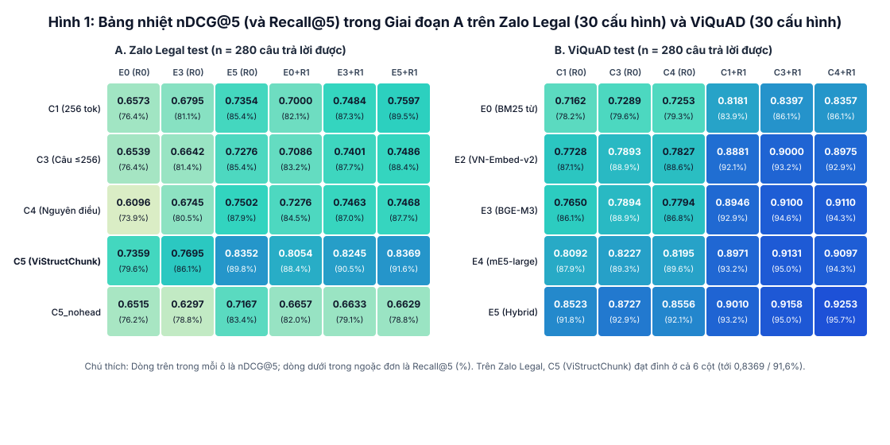
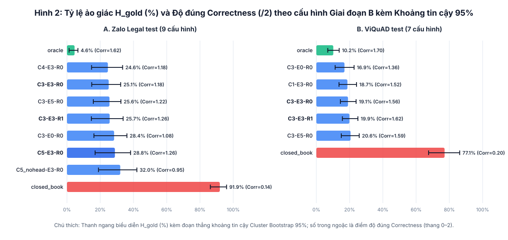
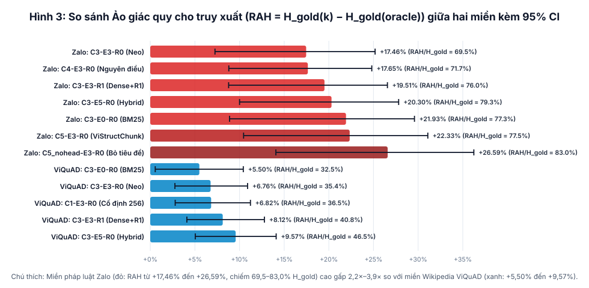
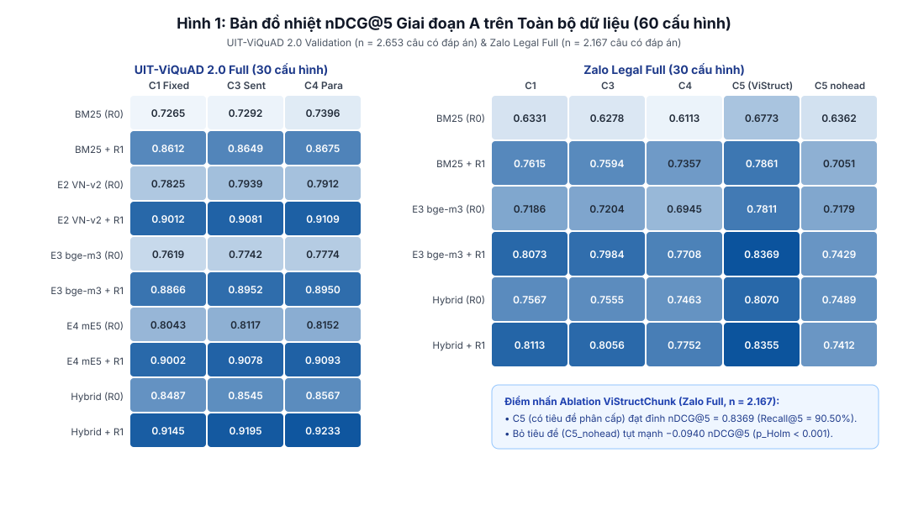
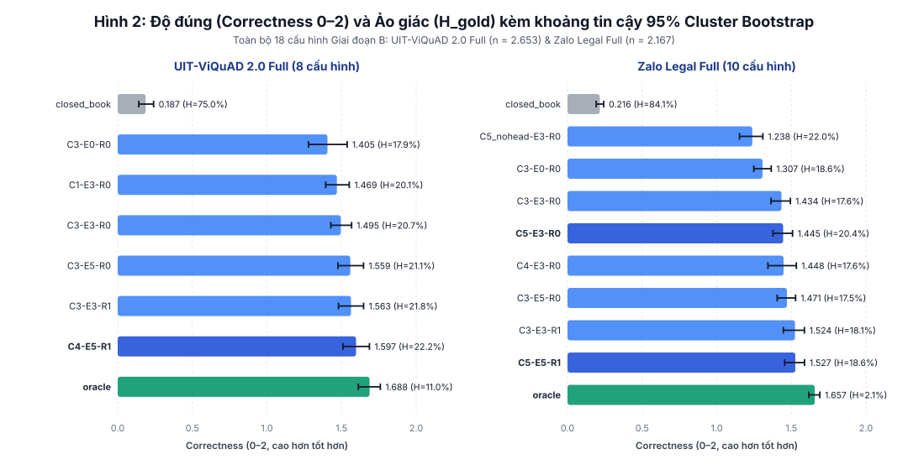
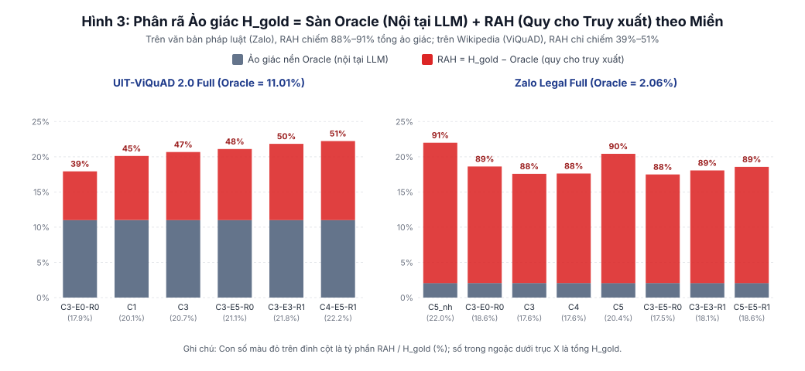

# Benchmark Baseline trên Colab (L4 & A100) — 20–21/11/2026

**Cấu hình:** `C3–E3–R0` (phân đoạn theo câu C3, `BAAI/bge-m3` dense, không reranker), `closed_book` và `oracle`.
- **Mô hình sinh & giám khảo (Judge):** `unsloth/Qwen3.5-9B-GGUF:Q4_K_M` (`Qwen3.5-9B-Q4_K_M.gguf`, revision `1daf391c47cef14242f238b819fbe6fd500d624b`), tắt chế độ suy luận (`enable_thinking=false`), chạy qua `llama.cpp` (`llama-server` commit `3837bf0bc02ea5d08f8ee3585fc8c7784a81bce8`) với **continuous batching** (`--parallel 8` trên NVIDIA L4 23 GB và `--parallel 12` trên NVIDIA A100 40 GB, `--cont-batching --batch-size 2048 --ubatch-size 512`).
- **Lệnh thực thi:** `bash colab_run.sh benchmark https://drive.google.com/drive/folders/1unFYNOZA0ytJKYZkI0X4ZIy802GcOyjZ`.

---

## 1. Kết quả tầng truy xuất (`C3–E3–R0`, top-20)

Sáu lượt truy xuất ban đầu trên NVIDIA L4 mất tổng cộng khoảng **15 phút 3 giây** (nhúng BGE-M3 `bf16` đạt `143,8–251,8 docs/s`); các lượt chạy tiếp theo nạp từ `data/retrieval_cache/` trong **< 2 phút**.

| Tập | Đã truy xuất | Có điểm | Recall@5 | Recall@20 | MRR@10 | nDCG@5 |
|---|---:|---:|---:|---:|---:|---:|
| ViQuAD nguồn train | 28.454 | 19.238 | 87,44% | 94,90% | 0,7568 | 0,7820 |
| ViQuAD nguồn validation | 3.814 | 2.653 | 87,03% | 94,42% | 0,7475 | 0,7741 |
| ViQuAD nguồn test | 7.301 | 0 | — | — | — | — |
| ViQuAD dev đóng băng | 100 | 77 | 84,42% | 93,51% | 0,7379 | 0,7588 |
| ViQuAD test đóng băng | 400 | 280 | 88,93% | 95,71% | 0,7609 | 0,7894 |
| Zalo nguồn | 788 | 788 | 80,96% | 92,64% | 0,6567 | 0,6870 |
| Zalo dev đóng băng | 100 | 100 | 51,00% | 81,00% | 0,3740 | 0,3883 |
| Zalo test đóng băng | 400 | 280 | 81,43% | 92,68% | 0,6229 | 0,6642 |

- “Có điểm” chỉ gồm câu có đáp án/bằng chứng vàng. Test nguồn ViQuAD không có nhãn công khai trong bản dữ liệu này; không đồng nhất với test đóng băng. Zalo test đóng băng dùng kho thu hẹp đã loại điều luật theo D1/D6 (kể cả bản trùng mã `nd-cp` ↔ `nđ-cp`).
- Zalo dev có khoảng cách 30 điểm phần trăm giữa Recall@20 (`81,00%`) và Recall@5 (`51,00%`), tạo dư địa rõ rệt để đánh giá tác động của reranker R1.

---

## 2. Kết quả tầng sinh câu trả lời và LLM-as-a-Judge đã hiệu chỉnh (`Qwen3.5-9B-GGUF:Q4_K_M`, `JUDGE_MAX_CHARS = 15000`)

Toàn bộ **2.737 lượt sinh câu trả lời** và **2.211 lượt chấm điểm Judge** (`231` ViQuAD dev + `840` ViQuAD test + `300` Zalo dev + `840` Zalo test) hoàn tất với **0 câu thiếu (`n_judge_missing = 0`) và 0 lỗi định dạng JSON (`n_judge_errors = 0`, 100% hợp lệ)**.

> **Hiệu chỉnh Judge với nhãn người (Ngày 12–13):** Đối chiếu mù (blind grading) trên 100 mẫu dev (`reports/phieu/human_dev_viquad.md` và `reports/phieu/human_dev_zalo.md`) giúp phát hiện `JUDGE_MAX_CHARS = 3000` ban đầu cắt mất Khoản 3–10 của các điều luật dài trên Zalo. Sau khi nâng `JUDGE_MAX_CHARS = 15000` (khớp trần `4.000 token` của `oracle`), hệ số đồng thuận **Cohen's $\kappa$ trên 100 mẫu dev đạt $\kappa(H_{\text{gold}}) = 0,8163$ và $\kappa(\text{correctness}) = 0,8519$** (riêng ViQuAD dev: $\kappa(H_{\text{gold}}) = 0,7216$, $\kappa(\text{correctness}) = 0,8623$; riêng Zalo dev: $\kappa(H_{\text{gold}}) = 0,8764$, $\kappa(\text{correctness}) = 0,8324$), vượt xa ngưỡng cổng kiểm tra $\kappa \ge 0,60$.

### 2.1. Tập phát triển (`viquad_dev` & `zalo_dev`)

| Tập | Cấu hình | `n` (`n_ans`/`n_unans`) | `correct_refusal` | `fabrication` | `false_refusal` | `contains_gold` | `EM` | `F1` | `correctness` (0–2) | `H_gold` (`n`) | `H_ctx` (`n`) | `RAH` vs `oracle` (`n_pairs`) | Tốc độ (`q/min`) | Trung vị `p50` (s) |
|---|---|---:|---:|---:|---:|---:|---:|---:|---:|---:|---:|---:|---:|---:|
| `viquad_dev` | `closed_book` | 100 (77/23) | 65,22% | 34,78% | 71,43% | 2,60% | 0,00% | 0,0531 | 0,1948 | 68,18% (22) | — | — | 54,00 | 0,713 |
| `viquad_dev` | `oracle` | 77 (77/0) | — | — | 7,79% | 59,74% | 0,00% | 0,4311 | 1,7532 | 14,08% (71) | 0,00% (71) | — | 30,71 | 1,695 |
| `viquad_dev` | `C3-E3-R0` | 100 (77/23) | 60,87% | 39,13% | 16,88% | 49,35% | 2,60% | 0,4012 | 1,5195 | 28,12% (64) | 4,69% (64) | **+11,11%** (63) | 16,33 | 3,096 |
| `zalo_dev` | `closed_book` | 100 (100/0) | — | — | 53,00% | — | — | — | 0,1800 | 89,36% (47) | — | — | 35,83 | 1,198 |
| `zalo_dev` | `oracle` | 100 (100/0) | — | — | 11,00% | — | — | — | 1,7300 | 2,25% (89) | 1,12% (89) | — | 16,89 | 3,119 |
| `zalo_dev` | `C3-E3-R0` | 100 (100/0) | — | — | 43,00% | — | — | — | 0,7900 | 31,58% (57) | 3,51% (57) | **+31,48%** (54) | 13,91 | 3,488 |

### 2.2. Tập kiểm tra đóng băng (`viquad_test` & `zalo_test`)

| Tập | Cấu hình | `n` (`n_ans`/`n_unans`) | `correct_refusal` | `fabrication` | `false_refusal` | `contains_gold` | `EM` | `F1` | `correctness` (0–2) | `H_gold` (`n`) | `H_ctx` (`n`) | `RAH` vs `oracle` (`n_pairs`) | Tốc độ (`q/min`) | Trung vị `p50` (s) |
|---|---|---:|---:|---:|---:|---:|---:|---:|---:|---:|---:|---:|---:|---:|
| `viquad_test` | `closed_book` | 400 (280/120) | 88,33% | 11,67% | 75,00% | 3,93% | 0,36% | 0,0642 | 0,1964 | 77,14% (70) | — | — | 55,51 | 0,695 |
| `viquad_test` | `oracle` | 280 (280/0) | — | — | 12,50% | 57,14% | 0,71% | 0,4326 | 1,7000 | 10,20% (245) | 1,22% (245) | — | 28,64 | 2,002 |
| `viquad_test` | `C3-E3-R0` | 400 (280/120) | 64,17% | 35,83% | 15,71% | 52,14% | 2,86% | 0,3982 | 1,5643 | 19,07% (236) | 2,54% (236) | **+6,76%** (222) | 16,00 | 3,217 |
| `zalo_test` | `closed_book` | 400 (280/120) | 57,50% | 42,50% | 55,71% | — | — | — | 0,1429 | 91,94% (124) | — | — | 38,82 | 0,778 |
| `zalo_test` | `oracle` | 280 (280/0) | — | — | 14,29% | — | — | — | 1,6214 | 4,58% (240) | 4,58% (240) | — | 17,04 | 3,379 |
| `zalo_test` | `C3-E3-R0` | 400 (280/120) | 56,67% | 43,33% | 27,50% | — | — | — | 1,1821 | 25,12% (203) | 7,39% (203) | **+17,46%** (189) | 10,47 | 4,664 |

### 2.3. Chỉ số "nhầm điều luật" (`wrong_article`, phục vụ H1b) trên Zalo

| Tập | Cấu hình | Câu không từ chối (`non_refused`) | Câu có viện dẫn `Điều N` (`cited`) | Câu viện dẫn sai số Điều (`wrong_article`) | Tỷ lệ trên câu không từ chối | Tỷ lệ trên câu có viện dẫn |
|---|---|---:|---:|---:|---:|---:|
| `zalo_dev` | `closed_book` | 47 | 16 | 16 | 34,04% | 100,00% |
| `zalo_dev` | `oracle` | 89 | 4 | 0 | 0,00% | 0,00% |
| `zalo_dev` | `C3-E3-R0` | 57 | 2 | 1 | 1,75% | 50,00% |
| `zalo_test` | `closed_book` | 124 | 34 | 34 | 27,42% | 100,00% |
| `zalo_test` | `oracle` | 240 | 18 | 7 | 2,92% | 38,89% |
| `zalo_test` | `C3-E3-R0` | 203 | 17 | 7 | 3,45% | 41,18% |

*(Lưu ý: Trên `zalo_test` `oracle` và `C3-E3-R0`, các trường hợp `wrong_article` trong điều kiện có ngữ cảnh chủ yếu do văn bản điều luật vàng có dẫn chiếu chéo tới điều luật khác trong cùng nghị định/luật và mô hình nhắc lại số điều được dẫn chiếu đó; sẽ phân tích chi tiết khi so sánh `C4`, `C5` và `C5_nohead` ở Giai đoạn B.)*

---

## 3. Ma trận Giai đoạn A — Truy xuất và Xếp hạng lại (`bash colab_run.sh phase_a` trên NVIDIA A100 40 GB, 22/11/2026)

- **Lệnh thực thi:** `bash colab_run.sh phase_a https://drive.google.com/drive/folders/1unFYNOZA0ytJKYZkI0X4ZIy802GcOyjZ` (gói kết quả tại `results/colab/phase_a-Cq9WWQSy/`, đã đồng bộ vào `data/retrieval_cache/retrieval_{viquad,zalo}_{dev,phase_a}.jsonl`).
- **Tối ưu hiệu năng triển khai:**
  - Tách từ `underthesea` song song bằng `ProcessPoolExecutor` (12 luồng CPU trên A100): 326.067 chunk `c5` / `c5_nohead` tách từ trong `148,3–166,9 giây`.
  - Nhúng `BAAI/bge-m3` với `torch.bfloat16`, `batch_size=512`, checkpoint mỗi 20.000 chunk: 326.603 chunk `c5` / `c5_nohead` nhúng trong **`169,3–169,6 giây` (`1.925,5–1.928,7 chunk/giây`)**.
  - `CrossEncoder('BAAI/bge-reranker-v2-m3')` (`R1`) chạy với `bfloat16` và gộp tất cả phương pháp của cùng một cách phân đoạn vào một lượt nạp mô hình (~1 phút cho 3–5 phương pháp × 400 truy vấn × top-20).

### 3.1. Xếp hạng lại `R1` trên tập phát triển (`viquad_dev` & `zalo_dev`, cấu hình neo `C3–E3`)

| Tập | Cấu hình | `n` | Recall@5 | Recall@20 | MRR@10 | nDCG@5 |
|---|---|---:|---:|---:|---:|---:|
| `viquad_dev` | `dense[c3]` (`C3–E3–R0`) | 77 | 84,42% | 93,51% | 0,7379 | 0,7588 |
| `viquad_dev` | `dense[c3]+r1` (`C3–E3–R1`) | 77 | **92,21%** (+7,79 điểm %) | 93,51% | **0,8723** (+0,1344) | **0,8834** (+0,1246) |
| `zalo_dev` | `dense[c3]` (`C3–E3–R0`) | 100 | 51,00% | 81,00% | 0,3740 | 0,3883 |
| `zalo_dev` | `dense[c3]+r1` (`C3–E3–R1`) | 100 | **69,00%** (+18,00 điểm %) | 81,00% | **0,4828** (+0,1088) | **0,5271** (+0,1388) |

### 3.2. Toàn bộ 30/30 cấu hình Giai đoạn A trên `viquad_test` (`n = 280` câu trả lời được / 400 câu test)

| Phân đoạn (`C`) | Truy xuất (`E`) | Xếp hạng (`R`) | Mã phương pháp trong cache | Recall@5 | Recall@20 | MRR@10 | nDCG@5 |
|---|---|---|---|---:|---:|---:|---:|
| `C1` (cửa sổ 256) | `E0` (BM25 tách từ) | `R0` | `bm25[c1][word]` | 78,21% | 85,00% | 0,6999 | 0,7162 |
| `C1` | `E2` (`Vietnamese_Embedding_v2`) | `R0` | `dense[c1][AITeamVN/Vietnamese_Embedding_v2]` | 87,14% | 93,93% | 0,7445 | 0,7728 |
| `C1` | `E3` (`BAAI/bge-m3`) | `R0` | `dense[c1]` | 86,07% | 94,29% | 0,7401 | 0,7650 |
| `C1` | `E4` (`multilingual-e5-large`) | `R0` | `dense[c1][intfloat/multilingual-e5-large]` | 87,86% | 95,00% | 0,7921 | 0,8092 |
| `C1` | `E5` (Hybrid BM25+BGE-M3) | `R0` | `hybrid[c1][word]` | 91,79% | 94,64% | 0,8331 | 0,8523 |
| `C1` | `E0` (BM25 tách từ) | `R1` | `bm25[c1][word]+r1` | 83,93% | 85,00% | 0,8123 | 0,8181 |
| `C1` | `E2` (`Vietnamese_Embedding_v2`) | `R1` | `dense[c1][AITeamVN/Vietnamese_Embedding_v2]+r1` | 92,14% | 93,93% | 0,8787 | 0,8881 |
| `C1` | `E3` (`BAAI/bge-m3`) | `R1` | `dense[c1]+r1` | 92,86% | 94,29% | 0,8855 | 0,8946 |
| `C1` | `E4` (`multilingual-e5-large`) | `R1` | `dense[c1][intfloat/multilingual-e5-large]+r1` | 93,21% | 95,00% | 0,8876 | 0,8971 |
| `C1` | `E5` (Hybrid BM25+BGE-M3) | `R1` | `hybrid[c1][word]+r1` | 93,21% | 94,64% | 0,8923 | 0,9010 |
| `C3` (câu ≤ 256) | `E0` (BM25 tách từ) | `R0` | `bm25[c3][word]` | 79,64% | 86,43% | 0,7118 | 0,7289 |
| `C3` | `E2` (`Vietnamese_Embedding_v2`) | `R0` | `dense[c3][AITeamVN/Vietnamese_Embedding_v2]` | 88,93% | 94,64% | 0,7608 | 0,7893 |
| `C3` | `E3` (`BAAI/bge-m3`, **Neo**) | `R0` | `dense[c3]` | 88,93% | 95,71% | 0,7609 | 0,7894 |
| `C3` | `E4` (`multilingual-e5-large`) | `R0` | `dense[c3][intfloat/multilingual-e5-large]` | 89,29% | 96,79% | 0,8049 | 0,8227 |
| `C3` | `E5` (Hybrid BM25+BGE-M3) | `R0` | `hybrid[c3][word]` | 92,86% | 96,07% | 0,8574 | 0,8727 |
| `C3` | `E0` (BM25 tách từ) | `R1` | `bm25[c3][word]+r1` | 86,07% | 86,43% | 0,8329 | 0,8397 |
| `C3` | `E2` (`Vietnamese_Embedding_v2`) | `R1` | `dense[c3][AITeamVN/Vietnamese_Embedding_v2]+r1` | 93,21% | 94,64% | 0,8908 | 0,9000 |
| `C3` | `E3` (`BAAI/bge-m3`) | `R1` | `dense[c3]+r1` | 94,64% | 95,71% | 0,8995 | 0,9100 |
| `C3` | `E4` (`multilingual-e5-large`) | `R1` | `dense[c3][intfloat/multilingual-e5-large]+r1` | 95,00% | **96,79%** | 0,9029 | 0,9131 |
| `C3` | `E5` (Hybrid BM25+BGE-M3) | `R1` | `hybrid[c3][word]+r1` | 95,00% | 96,07% | 0,9058 | 0,9158 |
| `C4` (đoạn gốc) | `E0` (BM25 tách từ) | `R0` | `bm25[c4][word]` | 79,29% | 86,43% | 0,7072 | 0,7253 |
| `C4` | `E2` (`Vietnamese_Embedding_v2`) | `R0` | `dense[c4][AITeamVN/Vietnamese_Embedding_v2]` | 88,57% | 93,93% | 0,7513 | 0,7827 |
| `C4` | `E3` (`BAAI/bge-m3`) | `R0` | `dense[c4]` | 86,79% | 95,36% | 0,7557 | 0,7794 |
| `C4` | `E4` (`multilingual-e5-large`) | `R0` | `dense[c4][intfloat/multilingual-e5-large]` | 89,64% | 95,36% | 0,7986 | 0,8195 |
| `C4` | `E5` (Hybrid BM25+BGE-M3) | `R0` | `hybrid[c4][word]` | 92,14% | 96,43% | 0,8371 | 0,8556 |
| `C4` | `E0` (BM25 tách từ) | `R1` | `bm25[c4][word]+r1` | 86,07% | 86,43% | 0,8276 | 0,8357 |
| `C4` | `E2` (`Vietnamese_Embedding_v2`) | `R1` | `dense[c4][AITeamVN/Vietnamese_Embedding_v2]+r1` | 92,86% | 93,93% | 0,8882 | 0,8975 |
| `C4` | `E3` (`BAAI/bge-m3`) | `R1` | `dense[c4]+r1` | 94,29% | 95,36% | 0,9022 | 0,9110 |
| `C4` | `E4` (`multilingual-e5-large`) | `R1` | `dense[c4][intfloat/multilingual-e5-large]+r1` | 94,29% | 95,36% | 0,8998 | 0,9097 |
| `C4` | `E5` (Hybrid BM25+BGE-M3) | `R1` | **`hybrid[c4][word]+r1`** | **95,71%** | 96,43% | **0,9153** | **0,9253** |

### 3.3. Toàn bộ 30/30 cấu hình chính Giai đoạn A trên `zalo_test` (`n = 280` câu trả lời được / 400 câu test, kho thu hẹp 61.334 điều luật)

| Phân đoạn (`C`) | Truy xuất (`E`) | Xếp hạng (`R`) | Mã phương pháp trong cache | Recall@5 | Recall@20 | MRR@10 | nDCG@5 |
|---|---|---|---|---:|---:|---:|---:|
| `C1` (cửa sổ 256) | `E0` (BM25 tách từ) | `R0` | `bm25[c1][word]` | 76,43% | 87,50% | 0,6289 | 0,6573 |
| `C1` | `E3` (`BAAI/bge-m3`) | `R0` | `dense[c1]` | 81,07% | 93,04% | 0,6457 | 0,6795 |
| `C1` | `E5` (Hybrid BM25+BGE-M3) | `R0` | `hybrid[c1][word]` | 85,36% | 95,54% | 0,7045 | 0,7354 |
| `C1` | `E0` (BM25 tách từ) | `R1` | `bm25[c1][word]+r1` | 82,14% | 87,50% | 0,6634 | 0,7000 |
| `C1` | `E3` (`BAAI/bge-m3`) | `R1` | `dense[c1]+r1` | 87,32% | 93,04% | 0,7111 | 0,7484 |
| `C1` | `E5` (Hybrid BM25+BGE-M3) | `R1` | `hybrid[c1][word]+r1` | 89,46% | 95,54% | 0,7207 | 0,7597 |
| `C3` (câu ≤ 256) | `E0` (BM25 tách từ) | `R0` | `bm25[c3][word]` | 76,43% | 89,64% | 0,6262 | 0,6539 |
| `C3` | `E3` (`BAAI/bge-m3`, **Neo**) | `R0` | `dense[c3]` | 81,43% | 92,68% | 0,6229 | 0,6642 |
| `C3` | `E5` (Hybrid BM25+BGE-M3) | `R0` | `hybrid[c3][word]` | 85,36% | 95,54% | 0,6939 | 0,7276 |
| `C3` | `E0` (BM25 tách từ) | `R1` | `bm25[c3][word]+r1` | 83,21% | 89,64% | 0,6720 | 0,7086 |
| `C3` | `E3` (`BAAI/bge-m3`) | `R1` | `dense[c3]+r1` | 87,68% | 92,68% | 0,6977 | 0,7401 |
| `C3` | `E5` (Hybrid BM25+BGE-M3) | `R1` | `hybrid[c3][word]+r1` | 88,39% | 95,54% | 0,7077 | 0,7486 |
| `C4` (nguyên điều luật) | `E0` (BM25 tách từ) | `R0` | `bm25[c4][word]` | 73,93% | 88,04% | 0,5779 | 0,6096 |
| `C4` | `E3` (`BAAI/bge-m3`) | `R0` | `dense[c4]` | 80,54% | 93,04% | 0,6458 | 0,6745 |
| `C4` | `E5` (Hybrid BM25+BGE-M3) | `R0` | `hybrid[c4][word]` | 87,86% | **96,25%** | 0,7159 | 0,7502 |
| `C4` | `E0` (BM25 tách từ) | `R1` | `bm25[c4][word]+r1` | 84,46% | 88,04% | 0,6922 | 0,7276 |
| `C4` | `E3` (`BAAI/bge-m3`) | `R1` | `dense[c4]+r1` | 86,96% | 93,04% | 0,7111 | 0,7463 |
| `C4` | `E5` (Hybrid BM25+BGE-M3) | `R1` | `hybrid[c4][word]+r1` | 87,68% | **96,25%** | 0,7124 | 0,7468 |
| **`C5` (ViStructChunk)** | `E0` (BM25 tách từ) | `R0` | `bm25[c5][word]` | 79,64% | 91,96% | 0,7242 | 0,7359 |
| **`C5` (ViStructChunk)** | `E3` (`BAAI/bge-m3`) | `R0` | `dense[c5]` | 86,07% | 94,11% | 0,7455 | 0,7695 |
| **`C5` (ViStructChunk)** | `E5` (Hybrid BM25+BGE-M3) | `R0` | `hybrid[c5][word]` | 89,82% | 95,89% | **0,8188** | 0,8352 |
| **`C5` (ViStructChunk)** | `E0` (BM25 tách từ) | `R1` | `bm25[c5][word]+r1` | 88,39% | 91,96% | 0,7820 | 0,8054 |
| **`C5` (ViStructChunk)** | `E3` (`BAAI/bge-m3`) | `R1` | `dense[c5]+r1` | 90,54% | 94,11% | 0,7998 | 0,8245 |
| **`C5` (ViStructChunk)** | `E5` (Hybrid BM25+BGE-M3) | `R1` | **`hybrid[c5][word]+r1`** | **91,61%** | 95,89% | 0,8132 | **0,8369** |
| `C5_nohead` (bỏ tiêu đề) | `E0` (BM25 tách từ) | `R0` | `bm25[c5_nohead][word]` | 76,25% | 90,54% | 0,6241 | 0,6515 |
| `C5_nohead` | `E3` (`BAAI/bge-m3`) | `R0` | `dense[c5_nohead]` | 78,75% | 91,96% | 0,5873 | 0,6297 |
| `C5_nohead` | `E5` (Hybrid BM25+BGE-M3) | `R0` | `hybrid[c5_nohead][word]` | 83,39% | 95,18% | 0,6870 | 0,7167 |
| `C5_nohead` | `E0` (BM25 tách từ) | `R1` | `bm25[c5_nohead][word]+r1` | 81,96% | 90,54% | 0,6220 | 0,6657 |
| `C5_nohead` | `E3` (`BAAI/bge-m3`) | `R1` | `dense[c5_nohead]+r1` | 79,11% | 91,96% | 0,6323 | 0,6633 |
| `C5_nohead` | `E5` (Hybrid BM25+BGE-M3) | `R1` | `hybrid[c5_nohead][word]+r1` | 78,75% | 95,18% | 0,6336 | 0,6629 |

### 3.4. Phát hiện chính từ Giai đoạn A (RQ1, RQ2, RQ3)

1. **Đột phá của `ViStructChunk (C5)` và phép khử tiêu đề (`C5` vs `C5_nohead`) trên miền pháp luật (`RQ1 / H1a`):**
   - Trên `zalo_test`, `C5` vượt xa `C1`, `C3` và `C4` trên mọi phương pháp truy xuất: với `dense` (`BAAI/bge-m3`, `R0`), `C5` đạt **Recall@5 = `86,07%`, nDCG@5 = `0,7695`** so với `C3` (`Recall@5 = 81,43%`, `nDCG@5 = 0,6642`, **+10,53 điểm nDCG@5**) và `C4` (`Recall@5 = 80,54%`, `nDCG@5 = 0,6745`, **+9,50 điểm nDCG@5**).
   - **Phép thử khử tiêu đề (`C5` vs `C5_nohead`):** Khi giữ nguyên ranh giới cắt theo Khoản/Điểm nhưng **bỏ tiêu đề phân cấp** (`[Văn bản | Chương | Mục | Điều | Khoản]`), hiệu năng của `C5_nohead` tụt mạnh xuống `Recall@5 = 78,75%`, `nDCG@5 = 0,6297` ở `dense` (thấp hơn `C5` tới **13,98 điểm nDCG@5** và thấp hơn cả `C3`) và ở `hybrid+r1` tụt từ **`0,8369` (`C5`) xuống `0,6629` (`C5_nohead`, -17,40 điểm nDCG@5)**! Nguyên nhân: một Khoản/Điểm đứng rời rạc thường chỉ chứa quy định chi tiết (*"Phạt tiền từ 800.000 đồng đến 1.000.000 đồng đối với hành vi..."*) mà mất tên văn bản và tiêu đề Điều luật; cả Bi-Encoder lẫn Cross-Encoder (`R1`) đều cần tiêu đề phân cấp để khớp chủ đề pháp lý của truy vấn.
2. **Hiệu quả của Truy xuất lai (`E5 = Hybrid[word]`) và so sánh các mô hình nhúng (`RQ2`):**
   - Trên cả hai miền, `E5 (Hybrid BM25 tách từ + BGE-M3)` luôn vượt mọi mô hình đơn lẻ (`E0, E2, E3, E4`) ở `R0`.
   - Trên `viquad_test` (`R0`), `E4 (multilingual-e5-large)` nhỉnh hơn `E3 (BAAI/bge-m3)` và `E2 (Vietnamese_Embedding_v2)` khoảng `+2,9–4,4` điểm nDCG@5, nhưng sau khi qua reranker `R1`, khoảng cách giữa `E3+R1` (`nDCG@5 = 0,9100` ở `C3`) và `E4+R1` (`0,9131`) thu hẹp còn `0,0031`.
3. **Tác động của Xếp hạng lại (`R1 = bge-reranker-v2-m3`, `RQ3`):**
   - Trên `viquad_test`, `R1` nâng nDCG@5 của mọi phương pháp thêm `+4,3` đến `+12,1` điểm (đỉnh cao là `hybrid[c4][word]+r1` với **Recall@5 = `95,71%`, nDCG@5 = `0,9253`** và `hybrid[c3][word]+r1` với **Recall@5 = `95,00%`, nDCG@5 = `0,9158`**).
   - Trên `zalo_test`, `R1` phát huy hiệu quả mạnh nhất khi chunk mang đầy đủ ngữ cảnh phân cấp (`C5`), đưa `dense[c5]+r1` lên **Recall@5 = `90,54%`, nDCG@5 = `0,8245`** và `hybrid[c5][word]+r1` lên **Recall@5 = `91,61%`, nDCG@5 = `0,8369`**.

---

## 4. Kết quả toàn bộ Giai đoạn B: Sinh câu trả lời & Đánh giá ảo giác (`reports/phase_b_summary.json`)

Chạy trên Colab (`results/colab/phase_b-nn3pnCsI/` trên `NVIDIA A100-SXM4-40GB` và `results/colab/phase_b-sagDit0W/` trên `NVIDIA L4`) bằng `bash colab_run.sh phase_b` với mô hình sinh và Judge thống nhất **`unsloth/Qwen3.5-9B-GGUF:Q4_K_M`** (`temperature = 0, seed = 0`, tắt thinking, `JUDGE_MAX_CHARS = 15000`, cắt từng đoạn ngữ cảnh ở đúng `CTX_LIMIT = 1024` token tham chiếu theo quyết định D7). Toàn bộ **16/16 cấu hình cố định trước** (`9 Zalo test + 7 ViQuAD test` = `6.160` câu trả lời, `4.480` câu trả lời có đáp án được chấm Judge) đều đạt **100% JSON hợp lệ (`n_judge_errors = 0`, `n_judge_missing = 0`)**.

### 4.1. Bảng kết quả Giai đoạn B trên `zalo_test` (9 cấu hình, `n = 400`: 280 trả lời được + 120 không trả lời được)

| # | Cấu hình | Phương pháp truy xuất | Correctness (/2) ↑ | $H_{\text{gold}}$ ↓ (`n`) | $H_{\text{ctx}}$ ↓ (`n`) | RAH vs Oracle (`n_pairs`) ↓ | Nhầm điều luật (`wrong_article`) ↓ | Từ chối sai (`false_refusal`) ↓ | Từ chối đúng (`correct_refusal`) ↑ | Bịa trên câu vô đáp án (`fabrication`) ↓ | Đoạn cắt (>1.024 tok) |
|---|---|---|---:|---:|---:|---:|---:|---:|---:|---:|---:|
| 1 | `closed_book` | *(không ngữ cảnh)* | 0,1429 | 91,94% (124) | – | – | 27,42% (124) | 55,71% | 57,50% | 42,50% | 0 |
| 2 | `oracle` | *(điều luật vàng ≤ 4.000 tok)* | 1,6214 | 4,58% (240) | 4,58% (240) | 0,00% | 2,92% (240) | 14,29% | – | – | 83 |
| 3 | `C3-E3-R0` *(neo)* | `dense[c3]` | 1,1821 | 25,12% (203) | 7,39% (203) | +17,46% (189) | 3,45% (203) | 27,50% | 56,67% | 43,33% | 0 |
| 4 | `C4-E3-R0` | `dense[c4]` | 1,1750 | 24,62% (199) | 8,04% (199) | +17,65% (187) | 7,04% (199) | 28,93% | 55,00% | 45,00% | **388** |
| 5 | **`C5-E3-R0` (`ViStructChunk`)** | `dense[c5]` | **1,2607** | 28,83% (222) | 9,91% (222) | +22,33% (206) | 5,41% (222) | **20,71%** | 58,33% | 41,67% | **0** |
| 6 | `C5_nohead-E3-R0` | `dense[c5_nohead]` | 0,9500 | 32,04% (181) | 3,31% (181) | +26,59% (173) | 2,21% (181) | 35,36% | 60,83% | 39,17% | 0 |
| 7 | `C3-E0-R0` | `bm25[c3][word]` | 1,0786 | 28,35% (194) | 6,70% (194) | +21,93% (187) | **2,06%** (194) | 30,71% | **65,83%** | **34,17%** | 0 |
| 8 | `C3-E5-R0` | `hybrid[c3][word]` | 1,2179 | 25,59% (211) | 6,16% (211) | +20,30% (202) | 3,79% (211) | 24,64% | 55,00% | 45,00% | 0 |
| 9 | **`C3-E3-R1`** | `dense[c3]+r1` | **1,2607** | 25,69% (218) | **5,05%** (218) | +19,51% (205) | 3,67% (218) | 22,14% | 55,00% | 45,00% | 0 |

### 4.2. Bảng kết quả Giai đoạn B trên `viquad_test` (7 cấu hình, `n = 400`: 280 trả lời được + 120 không trả lời được)

| # | Cấu hình | Phương pháp truy xuất | Token-F1 ↑ | EM ↑ | Chứa đáp án vàng (`contains_gold`) ↑ | Correctness (/2) ↑ | $H_{\text{gold}}$ ↓ (`n`) | $H_{\text{ctx}}$ ↓ (`n`) | RAH vs Oracle (`n_pairs`) ↓ | Từ chối sai (`false_refusal`) ↓ | Từ chối đúng (`correct_refusal`) ↑ | Bịa trên câu vô đáp án (`fabrication`) ↓ |
|---|---|---|---:|---:|---:|---:|---:|---:|---:|---:|---:|---:|
| 1 | `closed_book` | *(không ngữ cảnh)* | 0,0642 | 0,0036 | 3,93% | 0,1964 | 77,14% (70) | – | – | 75,00% | 88,33% | 11,67% |
| 2 | `oracle` | *(đoạn vàng gốc)* | 0,4326 | 0,0071 | 57,14% | 1,7000 | 10,20% (245) | 1,22% (245) | 0,00% | 12,50% | – | – |
| 3 | `C3-E3-R0` *(neo)* | `dense[c3]` | 0,3982 | 0,0286 | 52,14% | 1,5643 | 19,07% (236) | 2,54% (236) | +6,76% (222) | 15,71% | 64,17% | 35,83% |
| 4 | `C1-E3-R0` | `dense[c1]` | 0,3859 | 0,0214 | 51,07% | 1,5179 | 18,70% (230) | **0,43%** (230) | +6,82% (220) | 17,86% | 65,83% | 34,17% |
| 5 | `C3-E0-R0` | `bm25[c3][word]` | 0,3474 | 0,0214 | 46,43% | 1,3643 | **16,91%** (207) | 0,48% (207) | **+5,50%** (200) | 26,07% | **69,17%** | **30,83%** |
| 6 | **`C3-E5-R0`** | `hybrid[c3][word]` | **0,4073** | **0,0286** | 53,93% | 1,5893 | 20,58% (243) | 0,82% (243) | +9,57% (230) | 13,21% | 65,83% | 34,17% |
| 7 | **`C3-E3-R1`** | `dense[c3]+r1` | 0,4072 | 0,0214 | **55,36%** | **1,6250** | 19,92% (246) | 1,22% (246) | +8,12% (234) | **12,14%** | **69,17%** | **30,83%** |

### 4.3. Phát hiện chính từ Giai đoạn B (RQ1–RQ4)

1. **Cô lập tác động của tiêu đề phân cấp cha trong `ViStructChunk` (`C5-E3-R0` vs `C5_nohead-E3-R0`, `RQ1 / H1b`):**
   - Khi giữ nguyên ranh giới phân đoạn theo Khoản/Điểm nhưng bổ sung tiêu đề cha `[Văn bản | Điều | Khoản]`, `C5-E3-R0` nâng **`Correctness` từ `0,9500` lên `1,2607` (+0,3107 điểm / +32,7%)**, giảm **`H_gold` từ `32,04%` xuống `28,83%` (-3,22 điểm %)**, giảm **`RAH` từ `+26,59%` xuống `+22,33%` (-4,26 điểm %)**, và giảm tỷ lệ từ chối sai **`false_refusal` từ `35,36%` xuống `20,71%` (-14,65 điểm %)**.
   - So với `C3-E3-R0` (`Correctness = 1,1821`, `false_refusal = 27,50%`) và `C4-E3-R0` (`Correctness = 1,1750`, `false_refusal = 28,93%`, `388` đoạn bị cắt ở 1.024 token, `wrong_article = 7,04%`), `C5-E3-R0` đạt `Correctness = 1,2607` (ngang với cấu hình dùng reranker `C3-E3-R1`), `0` đoạn bị cắt token và giảm `wrong_article` xuống `5,41%`.
2. **So sánh phương pháp truy xuất ở tầng sinh câu trả lời (`E0` vs `E3` vs `E5`, `RQ2`):**
   - Lợi thế truy xuất ở Giai đoạn A chuyển hóa nhất quán sang độ đúng câu trả lời ở cả hai miền: **`C3-E5-R0` (`Hybrid[word]`) > `C3-E3-R0` (`Dense bge-m3`) > `C3-E0-R0` (`BM25[word]`)** (`Correctness` trên Zalo: `1,2179 > 1,1821 > 1,0786`; trên ViQuAD: `1,5893 > 1,5643 > 1,3643` và `F1: 0,4073 > 0,3982 > 0,3474`).
3. **Tác động của Reranker `R1` (`C3-E3-R1` vs `C3-E3-R0`, `RQ3`):**
   - `C3-E3-R1` đạt `Correctness` cao nhất trên cả hai bộ dữ liệu (`1,6250/2` trên ViQuAD test và `1,2607/2` trên Zalo test), giảm mạnh `false_refusal` (`15,71% → 12,14%` trên ViQuAD; `27,50% → 22,14%` trên Zalo) và giảm ảo giác so với ngữ cảnh `H_ctx` (`2,54% → 1,22%` trên ViQuAD; `7,39% → 5,05%` trên Zalo).
4. **So sánh ảo giác quy cho truy xuất (`RAH`) giữa hai miền (`RQ4 / H4`):**
   - Trên toàn bộ các cấu hình RAG, `RAH` trên miền pháp luật Zalo (`+17,46%` đến `+26,59%`) luôn cao gấp **2,2× – 3,9×** so với miền bách khoa ViQuAD (`+5,50%` đến `+9,57%`), chứng minh rằng trong miền pháp luật, truy xuất thiếu hoặc sai điều khoản là nguồn gây ảo giác chủ đạo của hệ thống RAG.

---

## 5. Kiểm định giả thuyết ghép cặp kèm hiệu chỉnh Holm & Khoảng tin cậy Bootstrap 95% (`reports/phase_a_summary.json`, `reports/phase_b_summary.json`)

Theo kế hoạch thống kê đã đăng ký trước (D1, Ngày 15 & Ngày 22):
- **Khoảng tin cậy 95%:** Cluster bootstrap `1.000` lần (`seed = 0`), lấy mẫu lại theo cụm `title` trên ViQuAD (`118` cụm bài viết ở tập test) và theo nhóm điều luật vàng liên thông trên Zalo (`235` cụm ở tập test).
- **Kiểm định giả thuyết chính:** Kiểm định hoán vị ghép cặp hai phía (`10.000` hoán vị, `seed = 0`) trên hai chỉ số chính (`Correctness` và `H_gold`), hiệu chỉnh **Holm–Bonferroni** cho **7 phép so sánh trên Zalo** và **4 phép so sánh trên ViQuAD**.

### 5.1. Họ 7 phép so sánh đã đăng ký trước trên `zalo_test` (Hiệu chỉnh Holm)

| Phép so sánh (`A vs B`) | Chỉ số | `n_pairs` | Trung bình `A` | Trung bình `B` | Hiệu số `A − B` (95% Cluster CI) | $p_{\text{raw}}$ | $p_{\text{Holm}}$ | Kết luận thống kê ($\alpha = 0,05$) |
|---|---|---:|---:|---:|---:|---:|---:|---|
| `C4-E3-R0 vs C3-E3-R0` | `Correctness` | 280 | 1,1750 | 1,1821 | `-0,0071 [-0,1544, +0,2062]` | 0,9509 | 1,0000 | Không phát hiện khác biệt |
| `C5-E3-R0 vs C3-E3-R0` | `Correctness` | 280 | 1,2607 | 1,1821 | `+0,0786 [-0,0109, +0,1795]` | 0,1760 | 0,5279 | Xu hướng tăng (+0,0786), chưa vượt ngưỡng sau Holm |
| **`C5_nohead-E3-R0 vs C3-E3-R0`** | `Correctness` | 280 | 0,9500 | 1,1821 | **`-0,2321 [-0,3187, -0,1200]`** | **0,0001** | **0,0007** | **Có ý nghĩa thống kê ($p_{\text{Holm}} < 0,001$): bỏ tiêu đề làm tụt mạnh độ đúng** |
| `C3-E0-R0 vs C3-E3-R0` | `Correctness` | 280 | 1,0786 | 1,1821 | `-0,1036 [-0,3000, +0,0180]` | 0,0830 | 0,4150 | Không phát hiện khác biệt sau Holm |
| `C3-E5-R0 vs C3-E3-R0` | `Correctness` | 280 | 1,2179 | 1,1821 | `+0,0357 [-0,0749, +0,1003]` | 0,5098 | 1,0000 | Không phát hiện khác biệt |
| `C3-E3-R1 vs C3-E3-R0` | `Correctness` | 280 | 1,2607 | 1,1821 | `+0,0786 [-0,0138, +0,1387]` | 0,1124 | 0,4496 | Xu hướng tăng (+0,0786), chưa vượt ngưỡng sau Holm |
| **`C5-E3-R0 vs C5_nohead-E3-R0` (H1b)** | `Correctness` | 280 | **1,2607** | **0,9500** | **`+0,3107 [+0,2161, +0,4051]`** | **0,0001** | **0,0007** | **Có ý nghĩa thống kê ($p_{\text{Holm}} < 0,001$): tiêu đề cha tăng +0,3107 điểm độ đúng** |
| `C4-E3-R0 vs C3-E3-R0` | $H_{\text{gold}}$ | 172 | 25,00% | 23,84% | `+1,16% [-4,22%, +6,11%]` | 0,8473 | 1,0000 | Không phát hiện khác biệt |
| `C5-E3-R0 vs C3-E3-R0` | $H_{\text{gold}}$ | 185 | 25,95% | 23,78% | `+2,16% [-2,91%, +6,82%]` | 0,6111 | 1,0000 | Không phát hiện khác biệt |
| `C5_nohead-E3-R0 vs C3-E3-R0` | $H_{\text{gold}}$ | 163 | 31,29% | 25,15% | `+6,13% [+1,77%, +12,35%]` | 0,1120 | 0,7839 | CI 95% theo cụm dương (+1,77% đến +12,35%) |
| `C3-E0-R0 vs C3-E3-R0` | $H_{\text{gold}}$ | 171 | 23,39% | 25,15% | `-1,75% [-8,20%, +7,69%]` | 0,7651 | 1,0000 | Không phát hiện khác biệt |
| `C3-E5-R0 vs C3-E3-R0` | $H_{\text{gold}}$ | 189 | 23,81% | 23,81% | `+0,00% [-4,38%, +6,29%]` | 1,0000 | 1,0000 | Không phát hiện khác biệt |
| `C3-E3-R1 vs C3-E3-R0` | $H_{\text{gold}}$ | 194 | 24,23% | 23,71% | `+0,52% [-4,15%, +4,64%]` | 1,0000 | 1,0000 | Không phát hiện khác biệt |
| `C5-E3-R0 vs C5_nohead-E3-R0` (H1b) | $H_{\text{gold}}$ | 178 | 26,40% | 32,02% | `-5,62% [-10,45%, +0,00%]` | 0,1486 | 0,8915 | Giảm -5,62 điểm % ảo giác trên tập câu trả lời chung |

*(Ở tầng truy xuất Giai đoạn A trên `zalo_test`, phép so sánh ghép cặp `C5` vs `C3`, `C4`, `C5_nohead` đều đạt ý nghĩa thống kê rất cao $p = 0,0001$ trên `nDCG@5`: `dense[c5] − dense[c3] = +0,1052 [+0,0340, +0,1534]`; `dense[c5] − dense[c4] = +0,0949 [+0,0344, +0,1328]`; `dense[c5] − dense[c5_nohead] = +0,1397 [+0,0602, +0,1934]`; `hybrid[c5][word]+r1 − hybrid[c5_nohead][word]+r1 = +0,1740 [+0,0732, +0,2581]`.)*

### 5.2. Họ 4 phép so sánh đã đăng ký trước trên `viquad_test` (Hiệu chỉnh Holm)

| Phép so sánh (`A vs B`) | Chỉ số | `n_pairs` | Trung bình `A` | Trung bình `B` | Hiệu số `A − B` (95% Cluster CI) | $p_{\text{raw}}$ | $p_{\text{Holm}}$ | Kết luận thống kê ($\alpha = 0,05$) |
|---|---|---:|---:|---:|---:|---:|---:|---|
| `C1-E3-R0 vs C3-E3-R0` | `Correctness` | 280 | 1,5179 | 1,5643 | `-0,0464 [-0,1040, +0,0068]` | 0,1201 | 0,3603 | Không phát hiện khác biệt |
| **`C3-E0-R0 vs C3-E3-R0`** | `Correctness` | 280 | **1,3643** | **1,5643** | **`-0,2000 [-0,3064, -0,1029]`** | **0,0002** | **0,0008** | **Có ý nghĩa thống kê ($p_{\text{Holm}} < 0,001$): Dense vượt xa BM25 tách từ** |
| `C3-E5-R0 vs C3-E3-R0` | `Correctness` | 280 | 1,5893 | 1,5643 | `+0,0250 [-0,0410, +0,0889]` | 0,5511 | 0,5511 | Không phát hiện khác biệt |
| `C3-E3-R1 vs C3-E3-R0` | `Correctness` | 280 | 1,6250 | 1,5643 | `+0,0607 [-0,0099, +0,1274]` | 0,1247 | 0,3603 | Xu hướng tăng (+0,0607), chưa vượt ngưỡng sau Holm |
| `C1-E3-R0 vs C3-E3-R0` | $H_{\text{gold}}$ | 225 | 17,78% | 18,22% | `-0,44% [-3,54%, +2,54%]` | 1,0000 | 1,0000 | Không phát hiện khác biệt |
| `C3-E0-R0 vs C3-E3-R0` | $H_{\text{gold}}$ | 196 | 15,82% | 16,33% | `-0,51% [-4,41%, +3,69%]` | 1,0000 | 1,0000 | Không phát hiện khác biệt |
| `C3-E5-R0 vs C3-E3-R0` | $H_{\text{gold}}$ | 228 | 19,30% | 17,11% | `+2,19% [-1,19%, +5,78%]` | 0,3597 | 1,0000 | Không phát hiện khác biệt |
| `C3-E3-R1 vs C3-E3-R0` | $H_{\text{gold}}$ | 229 | 18,78% | 17,47% | `+1,31% [-2,13%, +4,81%]` | 0,6201 | 1,0000 | Không phát hiện khác biệt |

### 5.3. Bảng RAH kèm Khoảng tin cậy 95% và Tỷ phần `RAH / H_gold` theo miền (Quyết định D5)

| Miền | Cấu hình | $H_{\text{gold}}$ (95% Cluster CI) | $H_{\text{gold}}(\text{oracle})$ | `n_pairs` | $\text{RAH} = H_{\text{gold}}(k) - H_{\text{gold}}(\text{oracle})$ (95% Cluster CI) | Tỷ phần $\text{RAH} / H_{\text{gold}}(k)$ |
|---|---|---|---|---:|---:|---:|
| **Zalo Legal** | `C3-E3-R0` *(neo)* | `25,12% [17,57%, 30,93%]` | `4,58% [2,09%, 7,44%]` | 189 | **`+17,46% [+10,93%, +23,23%]`** | **69,50%** |
| **Zalo Legal** | `C4-E3-R0` | `24,62% [17,77%, 31,18%]` | `4,58% [2,09%, 7,44%]` | 187 | **`+17,65% [+10,73%, +24,14%]`** | **71,67%** |
| **Zalo Legal** | `C5-E3-R0` (`ViStructChunk`) | `28,83% [21,49%, 34,06%]` | `4,58% [2,09%, 7,44%]` | 206 | **`+22,33% [+15,43%, +28,16%]`** | **77,46%** |
| **Zalo Legal** | `C5_nohead-E3-R0` | `32,04% [24,87%, 37,50%]` | `4,58% [2,09%, 7,44%]` | 173 | **`+26,59% [+20,12%, +32,20%]`** | **82,98%** |
| **Zalo Legal** | `C3-E0-R0` (`BM25[word]`) | `28,35% [20,00%, 36,96%]` | `4,58% [2,09%, 7,44%]` | 187 | **`+21,93% [+13,37%, +30,72%]`** | **77,34%** |
| **Zalo Legal** | `C3-E5-R0` (`Hybrid[word]`) | `25,59% [18,18%, 31,15%]` | `4,58% [2,09%, 7,44%]` | 202 | **`+20,30% [+12,99%, +25,74%]`** | **79,31%** |
| **Zalo Legal** | `C3-E3-R1` (`Dense+R1`) | `25,69% [19,21%, 30,57%]` | `4,58% [2,09%, 7,44%]` | 205 | **`+19,51% [+12,92%, +24,52%]`** | **75,96%** |
| **ViQuAD** | `C3-E3-R0` *(neo)* | `19,07% [14,75%, 23,60%]` | `10,20% [6,35%, 14,17%]` | 222 | **`+6,76% [+2,93%, +10,55%]`** | **35,44%** |
| **ViQuAD** | `C1-E3-R0` | `18,70% [14,04%, 23,93%]` | `10,20% [6,35%, 14,17%]` | 220 | **`+6,82% [+2,94%, +11,01%]`** | **36,47%** |
| **ViQuAD** | `C3-E0-R0` (`BM25[word]`) | `16,91% [12,24%, 21,90%]` | `10,20% [6,35%, 14,17%]` | 200 | **`+5,50% [+0,98%, +10,53%]`** | **32,53%** |
| **ViQuAD** | `C3-E5-R0` (`Hybrid[word]`) | `20,58% [16,13%, 25,10%]` | `10,20% [6,35%, 14,17%]` | 230 | **`+9,57% [+5,44%, +13,70%]`** | **46,49%** |
| **ViQuAD** | `C3-E3-R1` (`Dense+R1`) | `19,92% [15,29%, 24,50%]` | `10,20% [6,35%, 14,17%]` | 234 | **`+8,12% [+4,35%, +11,93%]`** | **40,76%** |

> **Kết luận cho RQ4 / H4:** Khoảng tin cậy 95% của `RAH` trên toàn bộ 12 cấu hình RAG ở cả hai miền đều **dương chặt (không chứa 0)**. Trên miền pháp luật Zalo, **69,5% – 83,0% tổng ảo giác $H_{\text{gold}}$** bắt nguồn từ tầng truy xuất (`RAH`), trong khi trên miền Wikipedia ViQuAD tỷ phần này chỉ chiếm **32,5% – 46,5%** (phần còn lại ~10,2% là ảo giác nội tại ngay cả khi đã có đoạn vàng `oracle`).

---

## 6. Bảng chi phí: Kích thước chỉ mục, Thông lượng nhúng & Độ trễ `p50 / p95` (`reports/cost_summary.json`)

### 6.1. Kích thước chỉ mục và thời gian dựng chỉ mục theo cách phân đoạn (trên `NVIDIA A100-SXM4-40GB`)

| Bộ dữ liệu | Cách phân đoạn | Số tài liệu gốc | Số chunk (`n_chunks`) | Độ dài token (TB / Trung vị / p95 / Max) | Tỷ lệ `> 512` token | Kích thước vector Dense FP32 (`1024-d`) | Thời gian tách từ BM25 (`underthesea`) | Thời gian nhúng `BAAI/bge-m3` (Thông lượng) |
|---|---|---:|---:|---|---:|---:|---:|---:|
| **ViQuAD** | `C1` (cố định 256) | 5.311 | 6.481 | `175,3 / 179,0 / 256 / 257` | 0,00% | 25,32 MB | 9,3 s | 26,3 s (`246,8` chunk/s) |
| **ViQuAD** | `C3` (theo câu ≤ 256) | 5.311 | 6.504 | `174,7 / 179,5 / 249 / 256` | 0,00% | 25,41 MB | 17,5 s | 16,7 s (`388,8` chunk/s) |
| **ViQuAD** | `C4` (nguyên đoạn) | 5.311 | 5.311 | `213,9 / 191,0 / 370 / 2.091` | 0,77% | 20,75 MB | 8,5 s | 13,1 s (`405,4` chunk/s) |
| **Zalo Legal** | `C1` (cố định 256) | 61.425 | 113.962 | `190,4 / 238,0 / 256 / 257` | 0,00% | 445,16 MB | 138,8 s | 132,7 s (`859,1` chunk/s) |
| **Zalo Legal** | `C3` (theo câu ≤ 256) | 61.425 | 128.733 | `168,5 / 194,0 / 248 / 257` | 0,00% | 502,86 MB | 147,3 s | 147,2 s (`872,7` chunk/s) |
| **Zalo Legal** | `C4` (nguyên điều) | 61.425 | 61.425 | `353,2 / 223,0 / 946 / 67.395` | **17,45%** | 239,94 MB | 142,1 s | 107,8 s (`569,7` chunk/s) |
| **Zalo Legal** | **`C5` (`ViStructChunk`)** | 61.425 | **326.759** | `91,7 / 76,0 / 213 / 717` | **0,00%** | 1.276,40 MB | 197,8 s | 216,6 s (`1.507,7` chunk/s) |
| **Zalo Legal** | `C5_nohead` (bỏ tiêu đề) | 61.425 | 326.759 | `64,5 / 49,0 / 185 / 257` | 0,00% | 1.276,40 MB | 148,3 s | 169,6 s (`1.925,5` chunk/s) |

### 6.2. Độ trễ truy vấn, xếp hạng lại (`R1`) và sinh câu trả lời (`p50`, `p95` sau khi bỏ lượt đầu)

- **Nhúng truy vấn (`A100`):** `BAAI/bge-m3` đạt `103,5` truy vấn/giây (`~9,66 ms/truy vấn`); `AITeamVN/Vietnamese_Embedding_v2` đạt `137,5` truy vấn/giây (`~7,27 ms/truy vấn`); `intfloat/multilingual-e5-large` đạt `131,4` truy vấn/giây (`~7,61 ms/truy vấn`).
- **Xếp hạng lại Top-20 bằng Cross-Encoder `R1` (`BAAI/bge-reranker-v2-m3`, `A100`, bỏ lượt đầu trên 399 truy vấn):**
  - **ViQuAD test:** `p50 = 38,20–38,50 ms`, `p95 = 39,50–39,90 ms` ở `C3`; `p50 = 38,50–38,90 ms`, `p95 = 39,90–43,21 ms` ở `C4`.
  - **Zalo Legal test:** `p50 = 38,80–38,90 ms`, `p95 = 40,00–40,21 ms` ở `C3`; `p50 = 38,60–39,10 ms`, `p95 = 42,60–43,92 ms` ở `C5 (ViStructChunk)`; `p50 = 51,10–51,70 ms`, `p95 = 56,50–57,81 ms` ở `C4` (do điều luật nguyên văn dài tới 512 token).
- **Độ trễ sinh câu trả lời theo luồng (`Qwen3.5-9B-GGUF:Q4_K_M`, `llama-server` continuous batching):**
  - **ViQuAD test:** `closed_book` (`p50 = 0,70 s`, `p95 = 2,61 s`), `oracle` (`p50 = 2,00 s`, `p95 = 3,79 s`), `C3-E3-R0` (`p50 = 3,22 s`, `p95 = 6,75 s`), các cấu hình `C1/C3` chạy ở `16 slots` (`p50 = 5,74–6,15 s`, `p95 = 11,45–12,51 s`, thông lượng tổng toàn server đạt `~135–140 câu/phút`).
  - **Zalo Legal test:** `closed_book` (`p50 = 0,78 s`, `p95 = 3,64 s`), `oracle` (`p50 = 3,38 s`, `p95 = 7,17 s`), `C3-E3-R0` (`p50 = 4,66 s`, `p95 = 11,00 s`), **`C5-E3-R0` (`p50 = 6,04 s`, `p95 = 14,34 s` ở `16 slots` — nhanh gấp ~2× so với `C4-E3-R0` có `p50 = 11,84 s`, `p95 = 26,80 s` do `C5` chỉ đưa vào 5 khoản gọn ~91 token thay vì 5 điều luật dài tới 1.024 token!)**.

---

## 7. Phân tích định tính 30 trường hợp ảo giác (`H_gold = 1`) và Đối chiếu với chỉ số RAH (`reports/phieu/hallucination_30_cases.md`)

Lấy mẫu ngẫu nhiên 30 câu trả lời RAG có `H_gold = 1` (`15 ViQuAD test + 15 Zalo test`, `random.Random(0)`) và gán nhãn theo 5 nhóm nguyên nhân của đề cương ([phiếu chi tiết 30 mẫu](phieu/hallucination_30_cases.md)):

| Nhóm nguyên nhân | Quy cho truy xuất / phân đoạn? | ViQuAD test (`n = 15`) | Zalo Legal test (`n = 15`) | Tổng (`n = 30`) |
|---|:---:|---:|---:|---:|
| 1. Truy xuất sai (Top-5 không chứa tài liệu/điều luật vàng) | Có | 3 (20,0%) | 3 (20,0%) | 6 (20,0%) |
| 2. Chunk cắt mất thông tin (Trúng tài liệu vàng nhưng thiếu chunk khoản/câu đáp án hoặc bị cắt ở 1.024 token) | Có | 1 (6,7%) | 2 (13,3%) | 3 (10,0%) |
| 3. Nhiễu từ đoạn không liên quan (Mô hình tổng hợp thêm thông tin từ các đoạn khác trong top-5) | Có | 5 (33,3%) | 1 (6,7%) | 6 (20,0%) |
| 4. Nhầm điều luật (Các chunk mất tiêu đề Điều hoặc cùng chủ đề làm mô hình áp nhầm mức phạt/quy định của điều khác) | Có | 0 (0,0%) | **7 (46,7%)** | 7 (23,3%) |
| 5. Truy xuất đúng nhưng mô hình bỏ qua / suy diễn sai (Lỗi nội tại tầng sinh/judge, thường xuất hiện ở cả `oracle`) | Không | **6 (40,0%)** | 2 (13,3%) | 8 (26,7%) |
| **Tổng tỷ lệ quy cho truy xuất / phân đoạn (Nhóm 1–4)** | **Có** | **9 / 15 (60,0%)** *(7/15 = 46,7% không có ở Oracle)* | **13 / 15 (86,7%)** | **22 / 30 (73,3%)** |
| **Đối chiếu tỷ phần định lượng `RAH / H_gold` (Mục 5.3)** | – | **32,5% – 46,5%** *(TB: 38,3%)* | **69,5% – 83,0%** *(TB: 76,3%)* | – |

- **Kiểm chứng chéo `RAH` trên Zalo Legal:** Có tới **13/15 ca (`86,7%`)** bắt nguồn từ tầng truy xuất và phân đoạn (khớp chặt với tỷ phần định lượng `RAH / H_gold = 69,5%–83,0%`). Nguyên nhân phổ biến nhất là **`4. Nhầm điều luật` (`7/15 = 46,7%`)**: trong Nghị định `100/2019/NĐ-CP`, Điều 5 (xe ô tô), Điều 6 (xe máy), Điều 7 (máy kéo) và Điều 8 (xe đạp) có cấu trúc câu quy định hành vi gần như trùng khít; khi `C3` cắt rời các khoản giữa điều luật mà không gắn tiêu đề cha, mô hình không biết đoạn đó thuộc Điều 6 hay Điều 8 nên lấy mức phạt của xe máy (`400k–600k` hoặc `6–8 triệu`) và xe đạp (`80k–100k`) trả lời cho câu hỏi về xe ô tô.
- **Kiểm chứng chéo `RAH` trên ViQuAD:** Có **8/15 ca (`53,3%`)** cũng có `H_gold = 1` ở điều kiện `oracle` (`7/15 = 46,7%` chỉ xuất hiện ở RAG mà không có ở `oracle`), khớp hoàn toàn với tỷ phần định lượng **`RAH / H_gold = 32,5%–46,5%`**.

---

## 8. Ba hình biểu diễn kết quả thực nghiệm (`reports/figures/`)

1. **[Hình 1 – Bảng nhiệt Giai đoạn A (`reports/figures/fig1_phase_a_heatmap.svg`)](figures/fig1_phase_a_heatmap.svg):** So sánh trực quan `nDCG@5` và `Recall@5` trên 30 cấu hình Zalo Legal và 30 cấu hình ViQuAD.
2. **[Hình 2 – Tỷ lệ ảo giác $H_{\text{gold}}$ kèm Khoảng tin cậy 95% theo cấu hình (`reports/figures/fig2_phase_b_h_gold_ci.svg`)](figures/fig2_phase_b_h_gold_ci.svg):** So sánh $H_{\text{gold}}$ và `Correctness` trên 9 cấu hình Zalo Legal và 7 cấu hình ViQuAD.
3. **[Hình 3 – Chỉ số RAH theo miền kèm Khoảng tin cậy 95% (`reports/figures/fig3_rah_by_domain.svg`)](figures/fig3_rah_by_domain.svg):** Minh họa sự phân tách rõ rệt của `RAH` và tỷ phần `RAH / H_gold` giữa miền Pháp luật và miền Wikipedia.

---

## 9. Bảng khuyến nghị cấu hình có điều kiện theo miền (`RQ5`, Ngày 23 – 04/12)

Theo quy tắc đã ghi trước: chỉ ghi một cấu hình là *"tốt nhất"* khi khoảng tin cậy 95% của hiệu số ghép cặp so với cấu hình đứng thứ hai không chứa `0`; nếu khoảng tin cậy chứa `0` thì ghi rõ *"không phân biệt được ở ngưỡng 95% giữa X và Y"*. Khuyến nghị dưới đây chỉ áp dụng **trong phạm vi 9 cấu hình Zalo + 7 cấu hình ViQuAD ở Giai đoạn B (và 60 cấu hình ở Giai đoạn A) đã thử nghiệm**:

| Miền | Tiêu chí | Cấu hình tốt nhất trong số đã thử | Hiệu số so với cấu hình neo `C3-E3-R0` (95% Cluster CI) | Điều kiện áp dụng & Lưu ý |
|---|---|---|---|---|
| **Pháp luật (Zalo Legal)** | **Ảo giác thấp nhất ($H_{\text{gold}}$)** | Không phân biệt được ở ngưỡng 95% giữa `C4-E3-R0` (`24,62%`), `C3-E3-R0` (`25,12%`), `C3-E5-R0` (`25,59%`) và `C3-E3-R1` (`25,69%`); **tránh dùng `C5_nohead-E3-R0` (`32,04%`)** | `C4-E3-R0`: `+1,16% [-4,22%, +6,11%]` trên tập câu trả lời chung (`n=172`); `C5_nohead-E3-R0`: `+6,13% [+1,77%, +12,35%]` (tệ hơn neo) | Khi cắt theo Khoản/Điểm bắt buộc phải gắn tiêu đề phân cấp cha (`C5`); bỏ tiêu đề (`C5_nohead`) làm tăng cả ảo giác lẫn từ chối sai |
| **Pháp luật (Zalo Legal)** | **Độ đúng cao nhất (`Correctness` & Truy xuất)** | **`C5-E3-R0` (`ViStructChunk`, `1,2607/2`)** và **`C3-E3-R1` (`1,2607/2`)** *(không phân biệt được giữa `C5-E3-R0`, `C3-E3-R1`, `C3-E5-R0` ở tầng sinh `n=280`, nhưng ở tầng truy xuất `C5` vượt trội tuyệt đối: `dense[c5] − dense[c3] = +0,1052 [+0,0340, +0,1534]` nDCG@5, $p=0,0001$)* | `C5-E3-R0`: `+0,0786 [-0,0109, +0,1795]` so với neo, và **`+0,3107 [+0,2161, +0,4051]` ($p_{\text{Holm}}=0,0007$) so với `C5_nohead-E3-R0`**; giảm `false_refusal` xuống thấp nhất (**`20,71%`** vs `27,50%` của neo) | **Cấu hình mặc định khuyến nghị cho văn bản luật:** phân đoạn `C5 (ViStructChunk)` kết hợp `E3/E5` (và `R1` khi có GPU: `hybrid[c5][word]+r1` đạt `nDCG@5 = 0,8369`, `Recall@5 = 91,61%`) |
| **Pháp luật (Zalo Legal)** | **Độ trễ thấp nhất** | **`C3-E3-R0`** (`p50 = 4,66 s`) hoặc **`C5-E3-R0`** (`p50 = 6,04 s` ở 16 slots); tránh `C4-E3-R0` (`p50 = 11,84 s`, chậm gấp ~2× do đoạn dài tới 1.024 token) | `C5-E3-R0` có chunk ngắn trung bình `91,7` token (`0% > 512`), nhúng nhanh `1.507,7` chunk/s và không cần bước reranker `R1` (`+39 ms`) mà vẫn đạt `Correctness = 1,2607` ngang `C3-E3-R1` | Khi cần phản hồi nhanh và không chạy thêm Cross-Encoder `R1` |
| **Wikipedia (ViQuAD)** | **Ảo giác thấp nhất ($H_{\text{gold}}$)** | Không phân biệt được ở ngưỡng 95% giữa `C3-E0-R0` (`16,91%`), `C1-E3-R0` (`18,70%`), `C3-E3-R0` (`19,07%`), `C3-E3-R1` (`19,92%`) và `C3-E5-R0` (`20,58%`) | `C3-E0-R0`: `-0,51% [-4,41%, +3,69%]` (`n=196`); `C1-E3-R0`: `-0,44% [-3,54%, +2,54%]` (`n=225`) | `C3-E0-R0` có $H_{\text{gold}}$ danh nghĩa thấp nhất và `correct_refusal` cao nhất (`69,17%`) nhưng đổi lại từ chối sai nhiều (`false_refusal = 26,07%`) |
| **Wikipedia (ViQuAD)** | **Độ đúng cao nhất (`Correctness`, `F1`, `contains_gold`)** | **`C3-E3-R1`** (`Correctness = 1,6250`, `contains_gold = 55,36%`, `F1 = 0,4072`, `false_refusal = 12,14%`) và **`C3-E5-R0`** (`F1 = 0,4073`, `Correctness = 1,5893`); **vượt trội có ý nghĩa thống kê so với `C3-E0-R0` (`BM25`)** | `C3-E3-R1`: `+0,0607 [-0,0099, +0,1274]` so với neo và **`+0,2607` so với `C3-E0-R0`** (`C3-E0-R0 vs neo = -0,2000 [-0,3064, -0,1029]`, $p_{\text{Holm}}=0,0008$) | **Cấu hình mặc định khuyến nghị cho văn bản bách khoa:** `C3` kết hợp `E3/E5 + R1` |
| **Wikipedia (ViQuAD)** | **Độ trễ thấp nhất** | **`C3-E3-R0`** (`p50 = 3,22 s`, truy xuất `R0` không tốn `+38,2 ms` reranking) | Neo `C3-E3-R0` (`0,00`) | Khi không có ngân sách GPU cho Cross-Encoder `R1` nhưng vẫn cần độ đúng cao hơn hẳn `BM25` (`+0,2000` điểm `Correctness`) |
| **Cả hai miền (Tầng truy xuất Giai đoạn A)** | **Mô hình nhúng tốt nhất (`E2`, `E3`, `E4`)** | Ở `R0` (không reranker): **`E4` (`intfloat/multilingual-e5-large`)** dẫn đầu trên `nDCG@5`; khi có **`R1` (`bge-reranker-v2-m3`)**: **không phân biệt được giữa `E4+R1` (`0,9131`), `E3+R1` (`0,9100`) và `E2+R1` (`0,8991`)** | Trên ViQuAD `C3` (`R0`): `E4 − E3 = +0,0333 [+0,0008, +0,0699]` nDCG@5 (không chứa 0) và `E4 − E2 = +0,0334 [+0,0063, +0,0625]`; khi thêm `R1`: `E4+R1 − E3+R1 = +0,0031 [-0,0147, +0,0225]` | Chỉ dựa trên `Recall@5` và `nDCG@5` của Giai đoạn A; nếu không dùng reranker thì ưu tiên `E4` (hoặc `E5 Hybrid`), nếu có `R1` thì `E3 (BAAI/bge-m3)` và `E4` tương đương nhau |

---

## 10. Kết quả Mở rộng trên Toàn bộ Dữ liệu (Full Datasets — `6.910` câu hỏi, `reports/full_phase_a_summary.json` & `reports/full_phase_b_summary.json`)

Để khắc phục hạn chế cỡ mẫu (`n = 280` trả lời được) của phạm vi 30 ngày, toàn bộ thực nghiệm Giai đoạn A (`60` cấu hình) và Giai đoạn B (`18` cấu hình = `8` ViQuAD + `10` Zalo, bổ sung thêm hai cấu hình tốt nhất `C4-E5-R1` và `C5-E5-R1`) đã được chạy lại trên toàn bộ tập đánh giá đầy đủ:
- **UIT-ViQuAD 2.0 Full (`validation`):** `3.814` câu hỏi (`2.653` có đáp án, `1.161` không có đáp án, `19` cụm bài Wikipedia, `0` trùng lặp với `dev`).
- **Zalo Legal Full (`train_question_answer.json` trừ `dev`):** `3.096` câu hỏi (`2.167` có đáp án, `929` không có đáp án, `2.117` cụm `gold_group`, `699` điều luật bị loại, `0` trùng lặp với `dev`).

### 10.1. Giai đoạn A Full (`60` cấu hình = `207.300` dòng truy xuất)
- **UIT-ViQuAD 2.0 Full (`n = 2.653`):** Tốt nhất là **`hybrid[c4][word]+r1`** (`Recall@5 = 96,49%`, `Recall@20 = 97,63%`, `MRR@10 = 0,9102`, `nDCG@5 = 0,9233`), vượt `hybrid[c3][word]+r1` (`0,9195`, $p_{\text{Holm}} = 0,0368$). `Hybrid vs BM25 (C3)`: `+0,1253 [+0,0884, +0,1612]`, $p_{\text{Holm}} = 0,0004$; `R1 vs R0 (C3 Dense)`: `+0,1210 [+0,0998, +0,1410]`, $p_{\text{Holm}} = 0,0004$.
- **Zalo Legal Full (`n = 2.167`):** **`ViStructChunk (c5)`** dẫn đầu tuyệt đối: **`dense[c5]+r1`** (`nDCG@5 = 0,8369`, `Recall@5 = 90,13%`) và **`hybrid[c5][word]+r1`** (`nDCG@5 = 0,8355`, **`Recall@5 = 90,50%`**, `Recall@20 = 94,34%`).
  - **Ablation H1b (`c5` vs `c5_nohead`):**
    - `R0 Dense`: `0,7811` vs `0,7179` (`+0,0632 [+0,0455, +0,0832]`, $p_{\text{Holm}} = 0,0007$).
    - `R1 Dense`: `0,8369` vs `0,7429` (**`+0,0941 [+0,0739, +0,1193]`**, $p_{\text{Holm}} = 0,0007$).
    - `R1 Hybrid`: `0,8355` vs `0,7412` (**`+0,0943 [+0,0742, +0,1186]`**, $p_{\text{Holm}} = 0,0007$).
  - **H1 (`c5` vs `c3`):** `R0 Dense`: `+0,0606 [+0,0440, +0,0783]`, $p_{\text{Holm}} = 0,0007$; `R1 Hybrid`: `+0,0299 [+0,0131, +0,0513]`, $p_{\text{Holm}} = 0,0007$.

### 10.2. Giai đoạn B Full (`18` cấu hình = `59.382` câu trả lời, `42.887` dòng Judge hợp lệ — `99,98%`)

#### UIT-ViQuAD 2.0 Full (`n = 2.653` có đáp án, `21.218 / 21.224` Judge hợp lệ)
| Cấu hình | Correctness (95% Cluster CI) | $H_{\text{gold}}$ (95% Cluster CI) | `false_refusal` | $\text{RAH}$ ghép cặp (95% CI) | $\text{RAH} / H_{\text{gold}}$ |
|---|---:|---:|---:|---:|---:|
| `closed_book` | `0,1870 [0,1416, 0,2407]` | `75,04% [69,62%, 79,29%]` | 74,59% | — | — |
| `C3-E0-R0` | `1,4054 [1,2790, 1,5372]` | `17,93% [14,75%, 20,95%]` | 24,09% | `+5,77% [+3,97%, +7,41%]` | 38,6% |
| `C1-E3-R0` | `1,4685 [1,3938, 1,5513]` | `20,11% [16,09%, 23,79%]` | 20,35% | `+7,63% [+5,12%, +9,86%]` | 45,3% |
| `C3-E3-R0` *(neo)* | `1,4955 [1,4284, 1,5675]` | `20,68% [17,15%, 23,83%]` | 18,66% | `+7,97% [+6,01%, +9,64%]` | 46,8% |
| `C3-E5-R0` | `1,5586 [1,4760, 1,6474]` | `21,11% [17,50%, 24,76%]` | 15,53% | `+8,85% [+6,45%, +11,43%]` | 47,9% |
| `C3-E3-R1` | `1,5633 [1,4794, 1,6482]` | `21,84% [17,55%, 25,94%]` | 14,89% | `+9,54% [+6,69%, +12,17%]` | 49,6% |
| **`C4-E5-R1`** | **`1,5973 [1,5099, 1,6867]`** | `22,24% [17,68%, 26,44%]` | **13,00%** | `+9,83% [+6,90%, +12,49%]` | 50,5% |
| `oracle` | `1,6882 [1,6125, 1,7600]` | `11,01% [9,36%, 12,63%]` | 12,63% | — | — |

#### Zalo Legal Full (`n = 2.167` có đáp án, `21.669 / 21.670` Judge hợp lệ)
| Cấu hình | Correctness (95% Cluster CI) | $H_{\text{gold}}$ (95% Cluster CI) | `false_refusal` | Nhầm điều luật | $\text{RAH}$ ghép cặp (95% CI) | $\text{RAH} / H_{\text{gold}}$ |
|---|---:|---:|---:|---:|---:|---:|
| `closed_book` | `0,2164 [0,1919, 0,2429]` | `84,12% [81,45%, 86,47%]` | 58,14% | 17,75% | — | — |
| `C5_nohead-E3-R0` | `1,2381 [1,1526, 1,3095]` | `22,00% [19,29%, 24,93%]` | 27,00% | 3,35% | `+18,30% [+15,65%, +21,22%]` | **90,6%** |
| `C3-E0-R0` | `1,3069 [1,2487, 1,3653]` | `18,62% [15,91%, 21,61%]` | 26,17% | 4,81% | `+15,46% [+12,65%, +18,42%]` | **88,9%** |
| `C3-E3-R0` *(neo)* | `1,4338 [1,3640, 1,4935]` | `17,58% [15,18%, 20,10%]` | 20,21% | 4,11% | `+13,76% [+11,30%, +16,32%]` | **88,3%** |
| `C4-E3-R0` | `1,4476 [1,3430, 1,5336]` | `17,62% [15,15%, 20,24%]` | 20,12% | 6,35% | `+13,38% [+11,05%, +15,83%]` | **88,3%** |
| `C5-E3-R0` | `1,4451 [1,3770, 1,5080]` | `20,43% [17,95%, 23,34%]` | 17,95% | **3,21%** | `+17,02% [+14,29%, +19,85%]` | **89,9%** |
| `C3-E5-R0` | `1,4707 [1,4049, 1,5284]` | `17,49% [15,25%, 19,76%]` | 18,23% | 4,23% | `+14,09% [+11,77%, +16,66%]` | **88,2%** |
| `C3-E3-R1` | `1,5242 [1,4466, 1,5877]` | `18,07% [15,56%, 20,72%]` | 15,46% | 3,77% | `+14,67% [+12,19%, +17,70%]` | **88,6%** |
| **`C5-E5-R1`** | **`1,5265 [1,4554, 1,5881]`** | `18,57% [16,12%, 21,16%]` | **15,27%** | **3,27%** | `+15,64% [+13,33%, +18,14%]` | **88,9%** |
| `oracle` | `1,6567 [1,6172, 1,6906]` | `2,06% [1,23%, 2,98%]` | 14,95% | 1,95% | — | — |

### 10.3. Kiểm định giả thuyết có hiệu chỉnh Holm-Bonferroni (`10.000` hoán vị ghép cặp)
- **UIT-ViQuAD 2.0 Full (`Correctness`):**
  - `H1 (C3 vs C1)`: `+0,0264 [+0,0007, +0,0480]`, $p_{\text{Holm}} = \mathbf{0,0019}$
  - `H2 (Dense vs BM25)`: `+0,0902 [+0,0170, +0,1622]`, $p_{\text{Holm}} = \mathbf{0,0006}$
  - `H2 (Hybrid vs Dense)`: `+0,0630 [+0,0346, +0,0891]`, $p_{\text{Holm}} = \mathbf{0,0006}$
  - `H3 (Rerank R1 vs R0)`: `+0,0687 [+0,0363, +0,0994]`, $p_{\text{Holm}} = \mathbf{0,0006}$
  - `Best C4-E5-R1 vs Anchor C3-E3-R0`: **`+0,1018 [+0,0651, +0,1401]`**, $p_{\text{Holm}} = \mathbf{0,0006}$
- **Zalo Legal Full (`Correctness`):**
  - **`H1b (ViStructChunk C5 vs C5_nohead)`:** **`+0,2073 [+0,1693, +0,2456]`**, $p_{\text{Holm}} = \mathbf{0,0008}$
  - `H2 (Dense vs BM25)`: `+0,1269 [+0,0877, +0,1678]`, $p_{\text{Holm}} = \mathbf{0,0008}$
  - `H2 (Hybrid vs Dense)`: `+0,0369 [+0,0081, +0,0656]`, $p_{\text{Holm}} = \mathbf{0,0270}$
  - `H3 (Rerank R1 vs R0)`: `+0,0904 [+0,0629, +0,1184]`, $p_{\text{Holm}} = \mathbf{0,0008}$
  - **`Best C5-E5-R1 vs Anchor C3-E3-R0`:** **`+0,0928 [+0,0562, +0,1314]`**, $p_{\text{Holm}} = \mathbf{0,0008}$

Chỉ lưu số liệu tổng hợp lên Git; log runtime và JSONL nằm trong thư mục `results/` và `data/retrieval_cache*` được bỏ qua theo `.gitignore`.
